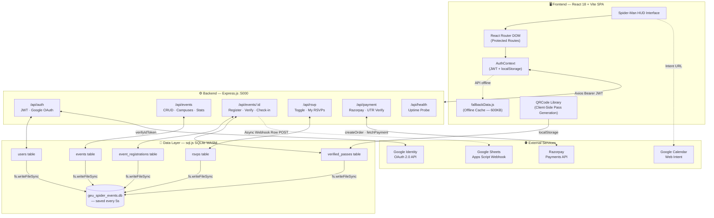
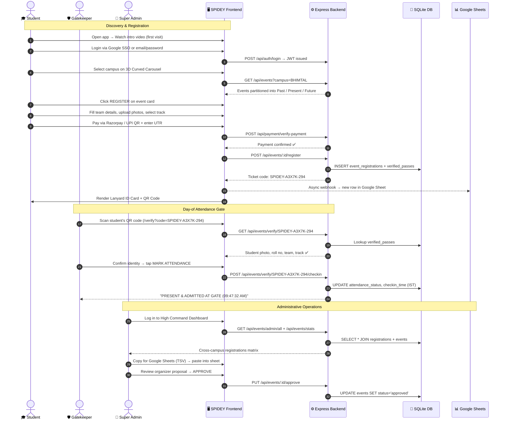

<div align="center">


# 🕷️ SPIDEY
### *Student Portal for Institutional Discovery, Events & Yardsticks*

**Graphic Era University · Quad-Campus Event Hub & Multiverse Student Platform**

<br/>

[](https://react.dev/)
[](https://vitejs.dev/)
[](https://tailwindcss.com/)
[](https://nodejs.org/)
[](https://expressjs.com/)
[](https://sql.js.org/)

<br/>

[](https://developers.google.com/identity)
[](https://razorpay.com/)
[](https://www.npci.org.in/what-we-do/upi/product-overview)
[](https://workspace.google.com/)
[](https://vercel.com/)
[](https://github.com/ujjwalchaudharyyy/SPIDEY/pulls)

<br/>

> *"With great events, comes great responsibility."*
> — The SPIDEY Platform Team, Graphic Era University

<br/>

[🚀 Quick Start](#-installation-and-local-setup) &nbsp;·&nbsp; [📡 API Docs](#-api-documentation) &nbsp;·&nbsp; [📐 Architecture](#-system-architecture-and-data-flow) &nbsp;·&nbsp; [🤝 Contribute](#-contributing-guidelines)

</div>

---

## 🌐 What is SPIDEY?

**SPIDEY** is a full-stack, Spider-Man multiverse–themed campus event platform purpose-built for the **Graphic Era University** group of institutions across Uttarakhand, India. It unites four distinct campuses into one synchronized digital grid — replacing scattered Google Forms, paper passes, and WhatsApp notifications with a professional, secure, and feature-rich web application.

<div align="center">

| 🏔️ Bhimtal Campus | ⚡ Haldwani Campus | 🏛️ Dehradun Campus | 🎓 Deemed University |
|:---:|:---:|:---:|:---:|
| High-Altitude Lake View | Gateway Cyber-Robotics | Flagship Centre of Excellence | NAAC A+ Research HQ |
| `#E21B24` Red Accent | `#0F52BA` Blue Accent | `#FFD700` Gold Accent | `#00F0FF` Cyan Accent |

</div>

From solo student RSVPs to 6-member hackathon squad registrations, from Razorpay checkout flows to mobile-first QR attendance scanning, SPIDEY delivers a zero-latency, production-grade experience that's equal parts functional and visually stunning.

---

## 📑 Table of Contents

| # | Section |
|---|---|
| A | [Problem Statement](#-problem-statement) |
| B | [Proposed Solution](#-proposed-solution) |
| C | [Objectives](#-objectives) |
| D | [Key Features](#-key-features) |
| E | [Complete Technology Stack](#-complete-technology-stack) |
| F | [System Architecture & Data Flow](#-system-architecture-and-data-flow) |
| G | [Project Folder Structure](#-project-folder-structure) |
| H | [Installation & Local Setup](#-installation-and-local-setup) |
| I | [Environment Variables](#-environment-variables) |
| J | [API Documentation](#-api-documentation) |
| K | [Database Design](#-database-design) |
| L | [User Workflow](#-user-workflow) |
| M | [Real Event Archives](#-real-event-archives) |
| N | [Deployment Guide](#-deployment-guide) |
| O | [Future Improvements](#-future-improvements) |
| P | [Contributing Guidelines](#-contributing-guidelines) |
| Q | [License & Acknowledgements](#-license-and-acknowledgements) |

---

## 📌 Problem Statement

Graphic Era runs multiple high-energy campuses simultaneously. National hackathons, cultural mega-fests, technical symposia, and athletic championships happen every semester — yet the infrastructure for discovering, registering for, and attending these events remained fragmented:

| ❌ Problem | 💢 Impact |
|---|---|
| **Campus Isolation** — events at Bhimtal go unnoticed in Dehradun | Low inter-campus participation and missed opportunities |
| **Ad-hoc Google Forms** — no duplicate prevention, no team management | Organizer overload, manual Excel cleanup every event |
| **Paper / PDF Passes** — easily forged, slow to verify at gates | Security loopholes, long queues, unauthorized entries |
| **No Institutional Memory** — event photos lost on personal drives | Campus legacy and achievements fade over time |
| **Disconnected UPI Payments** — screenshot matching against bank statements | Payment disputes, unverified attendees, financial chaos |
| **No Placement Portal** — T&P data scattered across departments | Students unaware of recruiters and placed alumni networks |

---

## 💡 Proposed Solution

SPIDEY addresses every pain point above with dedicated, integrated systems:

```
┌─────────────────────────────────────────────────────────────────────┐
│  📡 3D Curved Quad-Campus Radar                                     │
│     → Physics-based carousel gliding between all 4 campuses         │
│     → Auto-sorts events into Past · Present · Future timelines       │
├─────────────────────────────────────────────────────────────────────┤
│  🎟️ Multi-Step Team Registration Protocol                           │
│     → Solo & squad modes (up to 6 members), track selection         │
│     → Portrait photo upload per team member                         │
├─────────────────────────────────────────────────────────────────────┤
│  💳 Dual Payment Engine                                             │
│     → Razorpay Standard Checkout + HMAC SHA-256 verification        │
│     → Direct UPI QR generation + 12-digit UTR bank validation       │
├─────────────────────────────────────────────────────────────────────┤
│  🪪 Executive Lanyard ID Card Generator                             │
│     → University-branded pass with portrait, roll no & QR code      │
│     → Download, Print, Share on X / LinkedIn                        │
├─────────────────────────────────────────────────────────────────────┤
│  🛡️ Mobile Gatekeeper QR Verification Terminal                      │
│     → Public /verify route — no login needed for gate staff         │
│     → Timestamp-logged IST attendance marking                       │
├─────────────────────────────────────────────────────────────────────┤
│  📸 Concluded Event Photo Archives & Video Galleries                │
│     → Fullscreen lightbox · Auto-slideshow · Keyboard nav           │
│     → Drone surveillance 4K video player with rotation support      │
├─────────────────────────────────────────────────────────────────────┤
│  📊 Admin High Command Dashboard                                    │
│     → Live Google Sheets matrix · TSV export · Event approvals      │
│     → Cross-campus analytics and registration management            │
├─────────────────────────────────────────────────────────────────────┤
│  🏢 Training & Placement (T&P) Intelligence Hub                     │
│     → Recruiter directory · Placed student hall of fame             │
│     → Super Dream / Dream package tier filtering                    │
└─────────────────────────────────────────────────────────────────────┘
```

---

## 🎯 Objectives

- 🏫 **Quad-Campus Centralization** — one unified portal for all four Graphic Era institutions
- 🎟️ **Paperless Secure Ticketing** — cryptographic QR passes tied to verified roll numbers
- 📸 **Institutional Memory Preservation** — high-res photo archives of every past event
- 🛡️ **Streamlined Gate Operations** — IST-timestamped attendance marking in one tap
- 📴 **Offline Resilience** — comprehensive `fallbackData.js` keeps the app functional without a backend
- 💰 **Integrated Fee Collection** — end-to-end payment traceability (Razorpay + UPI)
- 📊 **Data-Driven Administration** — real-time Google Sheets sync and cross-campus analytics

---

## ⚡ Key Features

<details>
<summary><strong>🌐 1. Quad-Campus Radar & Timeline Engine</strong></summary>

- **3D Curved Carousel** (`CurvedCampusSlider.jsx`) — smooth physics-based sliding between Bhimtal 🏔️, Haldwani ⚡, Dehradun 🏛️, and Deemed 🎓 campuses with campus-specific neon glow accents
- **Cursor-Tracking Light Sensor Cards** (`CampusLeadershipSection.jsx`) — Stark-Tech spotlight effect on leadership portraits, following mouse position in real time
- **Automated Date Partitioning** (`CampusTimelineView.jsx`) — dynamically classifies every event into:
  - 🔴 **Past Events & Concluded Archives**
  - 🟢 **Present Day / Live Now**
  - 🔵 **Upcoming Missions & Announcements**
- **Google Calendar Direct Link** — every event card includes a one-click intent URL pre-filling title, venue, start/end time, campus address, and attendee email
- **Campus-Scoped Filtering** — campus selection propagates through every component ensuring Bhimtal students never see Haldwani-exclusive events

</details>

<details>
<summary><strong>📝 2. Multi-Step Event Registration Protocol</strong></summary>

- **Participation Modes** — toggle between Solo Registration and Team Registration (2–6 members)
- **Per-Member Portrait Upload** — each teammate uploads a JPEG/PNG photo via `FileReader` stored as Base64 data URLs (max 8MB per image)
- **Dynamic Team Slots** — adding/removing members auto-generates placeholder names and university roll numbers
- **Event Track Selection** — configurable tracks per event type:
  - 🤖 AI / Machine Learning Track · ☁️ Cloud & DevOps · 🌐 Web3 & Blockchain
  - 🎸 Battle of Bands / Rock Show · 🤼 Robowars Combat · 🏸 Athletics Spardha
- **Registration Isolation** — modal traps body scroll and keyboard focus, preventing accidental campus slider changes during form completion

</details>

<details>
<summary><strong>💳 3. Integrated Payment Gateways</strong></summary>

- **Razorpay Standard Checkout** — triggers native Razorpay modal (credit card, debit card, netbanking, UPI) with backend HMAC SHA-256 `order_id|payment_id` signature verification
- **Direct UPI QR Engine** — client-side QR rendered for `chaudharyujjwal@fam` with dynamic INR amount (₹1 test · ₹10 token · full team fee)
- **12-Digit Bank UTR Validation** — students paste their bank UTR reference, validated against Razorpay payment records
- **Flexible Pricing** — fee = ₹199 per member; solo = ₹199; 3-member team = ₹597 auto-calculated

</details>

<details>
<summary><strong>🪪 4. Executive Lanyard ID Pass Generator</strong></summary>

- **Snake Cascade View** — all team passes render simultaneously in a vertically stacked cascade for easy review
- **Cryptographic Ticket Codes** — auto-assigned unique IDs based on event type:
  - `SPIDEY-XXXXX-NNN` (general events)
  - `HTW-2027-XXXXX` (Hack The Winter)
  - `GRAFEST-XXXXX` (Cultural Fests)
- **QR Code** — high-density `qrcode` library generates verification URL encoded with ticket code, student name, roll number, email, campus, and team role
- **Card Actions** — Download PNG · Print Single Card · Batch Print All · Share on X (Twitter) · Share on LinkedIn
- **localStorage Sync** — pass data saved to `spider_verified_pass_<ticketCode>` for offline photo retrieval at gates

</details>

<details>
<summary><strong>🛡️ 5. Security Gatekeeper QR Verification Terminal</strong></summary>

- **Public Route** — `/verify` and `/verify/:code` require **zero login** — mobile-friendly for gate staff scanning on any browser
- **3-Layer Pass Lookup** — checks `verified_passes` table → `event_registrations` table → `details_json` nested attendee arrays
- **Photo Match Display** — shows attendee's uploaded portrait photo alongside Roll No, Campus, Degree, Team, and Track
- **Timestamped Check-In** — one-tap button writes `"PRESENT & ADMITTED AT GATE (HH:MM:SS AM/PM)"` in IST to `verified_passes.checkin_time`
- **Manual Code Entry** — fallback text input if QR camera scan fails

</details>

<details>
<summary><strong>📸 6. Concluded Event Galleries & Video Archives</strong></summary>

- **Responsive Photo Grid** — 1/2/3 column layouts adapting to viewport with hover-zoom and `#N` photo index badges
- **Fullscreen Lightbox** — high-resolution image viewer with auto-play slideshow (2.8s interval), touch-swipe gestures, keyboard arrows, and Escape to close
- **Event Highlights Panel** — structured festival highlights, winner team announcements, event overviews, and closing tribute banners
- **4K Drone Surveillance Video Player** — `EventVideoModal.jsx` with 90° rotation for corrected aerial footage, fullscreen API, and volume controls
- **Gallery Upload at Runtime** — gallery modal allows adding extra photos from local device which persist within the session

</details>

<details>
<summary><strong>👑 7. Administrative High Command Dashboard</strong></summary>

- **Super Admin vs Campus Admin** — super admin (`ujjwalchaudhary2007@gmail.com`) sees all 4 campuses; campus admins see their own
- **Registration Matrix** — searchable, filterable table of all attendee records across every event and campus
- **Google Sheets Integration** — configure per-event sheet URL and Apps Script webhook; one-click TSV export to clipboard pastes as formatted Google Sheets rows
- **Approval Queue** — inspect organizer-submitted events with full metadata and approve or reject with custom reason
- **Platform Statistics** — total events, pending approvals, approved archives, total RSVPs, registered users

</details>

<details>
<summary><strong>🏢 8. Training & Placement (T&P) Intelligence Hub</strong></summary>

- **Recruiter Directory** — interactive company cards with SVG logos (Google, Microsoft, Amazon, Adobe, TCS, Infosys, etc.) and CTC tiers
- **Placed Student Hall of Fame** — filterable profiles by Package Tier:
  - 🌟 **Super Dream** — ≥ ₹20 LPA
  - ⭐ **Dream** — ≥ ₹10 LPA
- **Multi-Campus Filter** — browse placements specifically for Bhimtal, Haldwani, Dehradun, or Deemed
- **Analytics Tab** — campus-wise placement statistics and company hiring breakdowns

</details>

<details>
<summary><strong>🕷️ 9. Stark-Tech Multiverse Aesthetic</strong></summary>

- **Spider-Web Canvas Transitions** — SVG web-blast animations and `thwip.mp3` sound effect triggered at every major navigation action
- **Cinematic Intro Modal** — first-visit video modal (`before_login.mp4`) plays automatically, stored to `sessionStorage` to avoid repeat plays
- **Sign-In / Sign-Out Video Modals** — custom cinematic transitions on login and logout
- **Custom Font Suite** — Chakra Petch (headers), Orbitron (stats), Rajdhani (body), JetBrains Mono (code & terminal text)
- **Campus-Specific Neon Accents** — each campus has its own border glow, badge colour, and shadow colour applied consistently across all components

</details>

> [!NOTE]
> **All 9 feature suites above are fully implemented and verified in the repository.** Future roadmap items (email delivery, native mobile app, WebSocket live chat) are clearly labelled in [Future Improvements](#-future-improvements).

---

## 💻 Complete Technology Stack

### 🖥️ Frontend
| Technology | Version | Role |
|---|---|---|
| **React** | `^18.2.0` | Component-based SPA framework |
| **Vite** | `^5.0.8` | Build tool with instant HMR |
| **React Router DOM** | `^6.21.1` | Client-side routing & protected routes |
| **Tailwind CSS** | `^3.4.0` | Utility-first styling + custom Spider-Man theme |
| **Axios** | `^1.6.2` | HTTP client for REST API communication |
| **QRCode** | `^1.5.4` | Client-side QR code generation |
| **PostCSS** | `^8.4.32` | CSS transformation pipeline |
| **Autoprefixer** | `^10.4.16` | Cross-browser vendor prefix injection |

### ⚙️ Backend
| Technology | Version | Role |
|---|---|---|
| **Node.js** | `≥ 18.0.0` | Server runtime environment |
| **Express.js** | `^4.18.2` | REST API server & static file hosting |
| **CORS** | `^2.8.5` | Cross-origin request middleware |
| **jsonwebtoken** | `^9.0.2` | JWT generation & 7-day token verification |
| **bcryptjs** | `^2.4.3` | Password hashing (salted, 10 rounds) |
| **google-auth-library** | `^9.15.1` | Google OAuth 2.0 ID token verification |
| **Node `crypto`** | *(built-in)* | HMAC SHA-256 Razorpay signature & safe buffer compare |

### 💾 Database & Persistence
| Technology | Version | Role |
|---|---|---|
| **sql.js** | `^1.9.0` | SQLite engine compiled to WebAssembly (zero native deps) |
| **SQLite file store** | *(binary)* | Disk snapshot every 5s → `backend/geu_spider_events.db` |
| **Browser LocalStorage** | *(Web API)* | Verified passes, JWT session, Google Sheets config, registration cache |
| **SessionStorage** | *(Web API)* | Intro video seen flag, preventing replay on refresh |

### 🌐 Third-Party Integrations
| Service | Type | Purpose |
|---|---|---|
| **Razorpay** | REST API + JS SDK | Payment order creation & HMAC verification |
| **UPI / NPCI** | Intent QR URI | Direct peer-to-merchant payment |
| **Google Identity** | OAuth 2.0 | One-tap SSO login |
| **Google Calendar** | Web Intent URL | Pre-filled event scheduling |
| **Google Sheets** | Apps Script Webhook | Live attendee row insertion |
| **Google Apps Script** | Deployed Web App | Backend-free sheet automation |

### 🚀 DevOps & Tooling
| Tool | Purpose |
|---|---|
| **Vercel** | Frontend SPA hosting with SPA rewrite rules |
| **PM2** | Recommended Node.js process manager for production backend |
| **`start.bat`** | Windows batch script for one-click dual-server launch |
| **Git** | Version control (hosted at `github.com/ujjwalchaudharyyy/SPIDEY`) |

---

## 🏗️ System Architecture and Data Flow

### High-Level Architecture



### Key Data Flows

**1. Campus Selection → Event Timeline**
```
User clicks campus tab
  → activeCampusIndex updates in StudentFeed.jsx
  → currentCampusEvents = events.filter(e => e.campus === activeCampus.name)
  → CampusTimelineView sorts by event_date vs todayStr
  → Past / Present / Future sections render automatically
```

**2. Registration → Pass → Gate Verification**
```
Student fills multi-step form + uploads photos
  → POST /api/events/:id/register
  → Backend generates ticket code (SPIDEY-XXXXX)
  → INSERT into event_registrations & verified_passes
  → Async POST to Google Sheets webhook
  → LanyardIDCard renders QR pointing to /verify?code=SPIDEY-XXXXX
  → Gatekeeper scans QR
  → GET /api/events/verify/:ticketCode
  → verified_passes lookup → show student photo
  → POST /verify/:ticketCode/checkin → mark PRESENT (IST timestamp)
```

**3. Payment Flow**
```
Student selects payment method
  → Razorpay: POST /api/payment/create-order → Razorpay SDK modal
    → POST /api/payment/verify-payment → HMAC SHA-256 check
  → UPI: client generates QR URI → student pays → enters 12-digit UTR
    → checked against Razorpay fetchPayment() API
  → On success → advance to ID card generation step
```

---

## 📁 Project Folder Structure

```
SPIDEY/
├── 📄 .env.example               ← Root env template (VITE + backend combined)
├── 📄 .gitignore
├── 📄 README.md                  ← You are here
├── 🪟 start.bat                  ← Windows one-click dual server launcher
├── 📄 vercel.json                ← Vercel SPA rewrite config
│
├── 📂 backend/                   ← Express.js REST API
│   ├── 📄 .env.example           ← Backend env template
│   ├── 📄 server.js              ← Entry point: CORS, body parser, route mounts
│   ├── 📄 db.js                  ← sql.js init, 5-table schema, 35+ seed events
│   ├── 🗄️ geu_spider_events.db  ← SQLite binary (auto-created on first run)
│   ├── 📄 package.json
│   └── 📂 routes/
│       ├── 📄 auth.js            ← Register, login, Google OAuth, /me
│       ├── 📄 events.js          ← Event CRUD, campuses list, approval, stats
│       ├── 📄 registrations.js   ← Register, verify/:code, check-in, attendees
│       ├── 📄 rsvp.js            ← Toggle RSVP, my RSVPs, RSVP status
│       └── 📄 payment.js         ← Razorpay order, verify-payment, order-status
│
└── 📂 frontend/                  ← React 18 + Vite SPA
    ├── 📄 index.html             ← HTML shell with Google Fonts CDN
    ├── 📄 vite.config.js         ← Vite bundler + dev proxy to :5000
    ├── 📄 tailwind.config.js     ← Custom Spider-Man colors, shadows & keyframes
    ├── 📄 package.json
    │
    ├── 📂 public/assets/
    │   ├── 🖼️ logo.png / spiderman_*.png
    │   ├── 🔊 thwip.mp3          ← Web-shooter sound effect
    │   ├── 📂 campuses/          ← 4K aerial photos (bhimtal/haldwani/dehradun/deemed)
    │   ├── 📂 leadership/        ← Chairman + campus directors portraits
    │   ├── 📂 videos/            ← Drone footage + cinematic login/logout clips
    │   └── 📂 events/
    │       ├── 📂 aws_ideathon/     ← INNOVATE 1.0 – AWS Ideathon (Bhimtal)
    │       ├── 📂 ganesh_chaturthi/ ← Ganesh Chaturthi Celebration (Bhimtal)
    │       ├── 📂 prayukti/         ← PRAYUKTI 2.0 Tech Fest (Bhimtal)
    │       ├── 📂 dussehra/         ← Dussehra Festival (Bhimtal)
    │       ├── 📂 sih/              ← Smart India Hackathon Grand Finale
    │       ├── 📂 grafest/          ← Student GRAFEST (Dehradun)
    │       ├── 📂 student_grafest/  ← Student Grafest Cultural (Dehradun)
    │       ├── 📂 haldwani_grafest/ ← Student Grafest Concerts (Haldwani)
    │       ├── 📂 foundation_day/   ← Silver Jubilee Foundation Day
    │       ├── 📂 sports/           ← Inter-campus athletics & cricket
    │       └── 📂 upcoming/         ← Promotional cards for future events
    │
    └── 📂 src/
        ├── 📄 main.jsx            ← React root renderer
        ├── 📄 App.jsx             ← Router config + protected route declarations
        ├── 📄 index.css           ← Global styles, custom scrollbars, spider keyframes
        │
        ├── 📂 components/
        │   ├── 🧩 CurvedCampusSlider.jsx      ← 3D curved quad-campus carousel
        │   ├── 🧩 CampusTimelineView.jsx       ← Past / Present / Future partitioner
        │   ├── 🧩 CampusLeadershipSection.jsx  ← Spotlight sensor leadership cards
        │   ├── 🧩 EventCard.jsx                ← Universal event preview card
        │   ├── 🧩 EventGalleryModal.jsx        ← Photo gallery + fullscreen lightbox
        │   ├── 🧩 EventRegistrationModal.jsx   ← Multi-step registration + payment
        │   ├── 🧩 EventVideoModal.jsx          ← Drone video player + rotation
        │   ├── 🧩 IntroVideoModal.jsx          ← First-visit cinematic intro
        │   ├── 🧩 SigninVideoModal.jsx         ← Login transition animation
        │   ├── 🧩 SignoutVideoModal.jsx        ← Logout transition animation
        │   ├── 🧩 WebShooterTransition.jsx     ← Canvas web-blast SVG animation
        │   ├── 🧩 Navbar.jsx                   ← Nav bar with role badges
        │   ├── 🧩 ProtectedRoute.jsx           ← JWT role-based route guard
        │   └── 🧩 CompanyLogo.jsx              ← T&P recruiter SVG logos
        │
        ├── 📂 context/
        │   └── 📄 AuthContext.jsx   ← React Context: JWT decode, login, logout
        │
        ├── 📂 data/
        │   └── 📄 fallbackData.js   ← 600KB offline dataset (36+ events, 4 campuses)
        │
        ├── 📂 pages/
        │   ├── 📄 Login.jsx           ← Spider-Man login + Google One-Tap SSO
        │   ├── 📄 Register.jsx        ← Campus-aware account registration
        │   ├── 📄 StudentFeed.jsx     ← Main campus radar + RSVP manager
        │   ├── 📄 OrganizerDashboard.jsx ← Event proposal submission console
        │   ├── 📄 AdminDashboard.jsx  ← High Command: approvals, registrations, sheets
        │   ├── 📄 Placement.jsx       ← T&P recruiter + placed student portal
        │   └── 📄 VerifyPass.jsx      ← Gatekeeper QR ticket verification
        │
        └── 📂 utils/
            ├── 📄 calendarUtils.js      ← Google Calendar intent URL generator
            └── 📄 googleSheetsSync.js   ← Apps Script webhook + TSV clipboard export
```

---

## 🚀 Installation and Local Setup

### Prerequisites

| Requirement | Minimum Version | Check Command |
|---|---|---|
| **Node.js** | v18.0.0 | `node --version` |
| **npm** | v9.0.0 | `npm --version` |
| **Git** | Any recent | `git --version` |

### Option A — One-Click (Windows Only)

```cmd
git clone https://github.com/ujjwalchaudharyyy/SPIDEY.git
cd SPIDEY
start.bat
```

> This opens two terminal windows: the backend on **:5000** and the frontend on **:5173**.

### Option B — Manual Setup

**Terminal 1 — Backend**
```bash
# Clone repository
git clone https://github.com/ujjwalchaudharyyy/SPIDEY.git
cd SPIDEY/backend

# Install dependencies
npm install

# Configure environment
cp .env.example .env
# Edit .env with your credentials (JWT_SECRET is required)

# Start backend server
npm start
# ✅ Backend running at http://localhost:5000
# ✅ SQLite database initialized (geu_spider_events.db)
```

**Terminal 2 — Frontend**
```bash
cd SPIDEY/frontend

# Install dependencies
npm install

# Start development server
npm run dev
# ✅ Frontend running at http://localhost:5173
```

**Open in browser:** [http://localhost:5173](http://localhost:5173)

### Demo Credentials

| Role | Email | Password | Access Scope |
|---|---|---|---|
| 🔴 **Super Admin** | `admin@campus.edu` | `admin123` | All 4 campuses + Admin Dashboard |
| 🟡 **Organizer** | Register via `/register` | Custom | Submit & manage own events |
| 🔵 **Student** | Register or Google SSO | Custom | Browse, RSVP, register for events |

> [!TIP]
> Use **Google Sign-In** on the login page for instant access. Google-authenticated users are automatically provisioned as students. The super-admin Google account (`ujjwalchaudhary2007@gmail.com`) is automatically elevated to full Admin access.

---

## 🔐 Environment Variables

Create `.env` files from the provided `.env.example` templates. **Never commit real secrets to git.**

### `backend/.env`

| Variable | Required | Default / Placeholder | Description |
|---|---|---|---|
| `PORT` | Optional | `5000` | Express server listen port |
| `JWT_SECRET` | ✅ **Yes** | `campus_event_hub_secret_2024` | Cryptographic key for JWT signing (change in production!) |
| `GOOGLE_CLIENT_ID` | Optional | `your-client-id.apps.googleusercontent.com` | Google OAuth 2.0 Web Client ID for SSO token validation |
| `RAZORPAY_KEY_ID` | Optional | `rzp_test_YOUR_KEY_HERE` | Razorpay public key (test or live) |
| `RAZORPAY_KEY_SECRET` | Optional | `YOUR_KEY_SECRET_HERE` | Razorpay secret for HMAC SHA-256 verification |
| `RAZORPAY_WEBHOOK_SECRET` | Optional | `YOUR_WEBHOOK_SECRET_HERE` | For Razorpay webhook event authentication |
| `FRONTEND_URL` | Optional | `http://localhost:5173` | Allowed CORS origin for production |

### `frontend/.env` (Vite)

| Variable | Required | Placeholder | Description |
|---|---|---|---|
| `VITE_GOOGLE_CLIENT_ID` | Optional | `your-client-id.apps.googleusercontent.com` | Google OAuth 2.0 Client ID exposed to browser |

> [!IMPORTANT]
> The platform is fully functional without Google or Razorpay credentials. Those features gracefully degrade — email/password auth and UPI manual entry remain fully operational.

---

## 📡 API Documentation

All endpoints are served under `http://localhost:5000/api`.

### 🔑 Auth (`/api/auth`)

| Method | Endpoint | Auth | Description |
|---|---|---|---|
| `POST` | `/auth/register` | Public | Create student or organizer account |
| `POST` | `/auth/login` | Public | Email + password login → JWT |
| `POST` | `/auth/google` | Public | Google ID token → auto-provision + JWT |
| `GET` | `/auth/me` | 🔒 Bearer JWT | Return current user profile |

<details>
<summary>Register Request Body</summary>

```json
{
  "name": "Aryan Sharma",
  "email": "aryan@gehu.ac.in",
  "password": "secure123",
  "role": "student",
  "campus": "GRAPHIC ERA HILL UNIVERSITY BHIMTAL",
  "phone": "+91 98765 43210",
  "degree": "B.Tech CSE"
}
```
</details>

---

### 📅 Events (`/api/events`)

| Method | Endpoint | Auth | Description |
|---|---|---|---|
| `GET` | `/events` | Public | List approved events; query: `campus`, `category`, `timeline`, `search` |
| `GET` | `/events/campuses` | Public | Return metadata for all 4 Graphic Era campuses |
| `GET` | `/events/categories` | Public | Return allowed event category list |
| `GET` | `/events/stats` | 🔒 Admin | Platform-wide statistics |
| `GET` | `/events/pending` | 🔒 Admin | Events awaiting review |
| `GET` | `/events/all` | 🔒 Admin | All events regardless of status |
| `GET` | `/events/my` | 🔒 Organizer | Events submitted by current organizer |
| `POST` | `/events/submit` | 🔒 Organizer | Submit new event proposal (status: pending) |
| `PUT` | `/events/:id/approve` | 🔒 Admin | Approve a pending event |
| `PUT` | `/events/:id/reject` | 🔒 Admin | Reject with reason |
| `DELETE` | `/events/:id` | 🔒 Admin/Owner | Delete event and its RSVPs |

---

### 🎟️ Registrations & Passes (`/api/events`)

| Method | Endpoint | Auth | Description |
|---|---|---|---|
| `POST` | `/events/:id/register` | 🔒 Student | Register for event; generates ticket code |
| `GET` | `/events/registrations/my` | 🔒 Student | My event registrations |
| `GET` | `/events/admin/all` | 🔒 Super Admin | All registrations across all campuses |
| `GET` | `/events/:id/attendees` | 🔒 Admin/Organizer | Attendee roster for an event |
| `GET` | `/events/verify/:ticketCode` | 🌐 **Public** | QR pass verification lookup |
| `POST` | `/events/verify/:ticketCode/checkin` | 🌐 **Public** | Mark attendance (IST timestamp) |
| `POST` | `/events/verify/save-passes` | 🌐 **Public** | Bulk-sync passes from frontend |

---

### 📌 RSVP (`/api/rsvp`)

| Method | Endpoint | Auth | Description |
|---|---|---|---|
| `POST` | `/rsvp/:eventId` | 🔒 Student | Toggle RSVP on/off |
| `GET` | `/rsvp/my` | 🔒 Student | List all RSVPed events |
| `GET` | `/rsvp/status/:eventId` | 🔒 JWT | Check RSVP status for a specific event |

---

### 💳 Payments (`/api/payment`)

| Method | Endpoint | Auth | Description |
|---|---|---|---|
| `POST` | `/payment/create-order` | Public | Create Razorpay order or in-memory fallback |
| `POST` | `/payment/verify-payment` | Public | Verify HMAC SHA-256 signature |
| `GET` | `/payment/order-status` | Public | Check if order `order_id` is confirmed paid |
| `GET` | `/health` | Public | Server uptime check |

---

## 🗄️ Database Design

SPIDEY uses **sql.js** (SQLite compiled to WebAssembly). The database file is auto-created at `backend/geu_spider_events.db` on first run and saved to disk every 5 seconds.

### Entity-Relationship Overview

```
users ──────────────┬──────────────── events
  │ id              │ organizer_id      │ id
  │ name            │                   │ title, description
  │ email (UNIQUE)  │                   │ category, venue
  │ password (hash) │                   │ campus
  │ role            │                   │ image_url
  │ campus          │                   │ photos (JSON array)
  │ phone, degree   │                   │ gallery (JSON array)
  │ created_at      │                   │ highlights (JSON array)
  │                 │                   │ overview, closing_message
  │                 │                   │ event_date, event_time
  │                 │                   │ status (pending/approved/rejected)
  │                 │                   │ rejection_reason, display_date
  ├── rsvps         │                   ├── event_registrations
  │   user_id ──────┘                   │   event_id ──┘
  │   event_id                          │   user_id
  │   reminded                          │   student_name, email, phone
  │   UNIQUE(user_id, event_id)         │   roll_no, campus, degree
  │                                     │   ticket_code (UNIQUE)
  │                                     │   team_name, team_size
  │                                     │   track_info, github_link
  │                                     │   details_json (nested attendees)
  │                                     │
  └── verified_passes (PK: ticket_code)
      event_id, event_title, event_campus
      student_name, email, roll_no, campus
      team_name, role_in_team, track_info
      photo_url (Base64 data URL)
      attendance_status
      checkin_time (IST string)
      created_at
```

### Table Summary

| Table | Rows | Key Purpose |
|---|---|---|
| `users` | Seeded admin + new registrations | User accounts with role & campus |
| `events` | 36+ seeded across 4 campuses | Full event metadata including JSON photo arrays |
| `rsvps` | Per-student event interests | UNIQUE(user_id, event_id) toggle |
| `event_registrations` | Full registration records | Ticket codes + team details + JSON attendees |
| `verified_passes` | High-speed gate lookups | Student portrait, attendance status, IST check-in |

---

## 🔄 User Workflow



---

## 📸 Real Event Archives

SPIDEY preserves authentic memories from actual Graphic Era campus events. All photographs are real — not stock or AI-generated.

<div align="center">

| Event | Campus | Category | Photos |
|---|---|---|---|
| 🤖 **Smart India Hackathon 2026 Grand Finale** | Dehradun | Hackathon / Technical | [`/events/sih/`](frontend/public/assets/events/sih/) |
| 🎵 **Student GRAFEST 2026 — Pyrotechnics & Concert** | Haldwani | Cultural Fest | [`/events/haldwani_grafest/`](frontend/public/assets/events/haldwani_grafest/) |
| 🎊 **Student Grafest — Dance & Music Showcase** | Dehradun | Student Festival | [`/events/student_grafest/`](frontend/public/assets/events/student_grafest/) |
| 🎭 **GRAPHITE Live Cultural Extravaganza** | Bhimtal/Dehradun | Cultural | [`/events/graphite_live_*.jpg`](frontend/public/assets/events/) |
| ⚙️ **PRAYUKTI 2.0 — Robowars & Tech Fest 2026** | Bhimtal | Technical / Cultural Fest | [`/events/prayukti/`](frontend/public/assets/events/prayukti/) |
| ☁️ **INNOVATE 1.0 — AWS Ideathon** | Bhimtal | Technology / Ideathon | [`/events/aws_ideathon/`](frontend/public/assets/events/aws_ideathon/) |
| 💻 **Watch The Code — National Hackathon** | Haldwani | Technical | [`/events/watch_the_code_*.jpg`](frontend/public/assets/events/) |
| 🪔 **Dussehra Cultural Celebration** | Bhimtal | Cultural / Religious | [`/events/dussehra/`](frontend/public/assets/events/dussehra/) |
| 🐘 **Ganesh Chaturthi Utsav** | Bhimtal | Cultural / Religious Festival | [`/events/ganesh_chaturthi/`](frontend/public/assets/events/ganesh_chaturthi/) |
| 🏛️ **Silver Jubilee Foundation Day** | Dehradun | University Event | [`/events/foundation_day/`](frontend/public/assets/events/foundation_day/) |

</div>

---

## 🚢 Deployment Guide

### Frontend — Vercel (Recommended)

The root `vercel.json` rewrites all paths to the SPA:

```json
{
  "version": 2,
  "rewrites": [{ "source": "/(.*)", "destination": "/frontend/index.html" }]
}
```

Steps:
1. Push your repository to GitHub
2. Import project in [vercel.com/new](https://vercel.com/new)
3. Set **Root Directory** → `frontend`
4. Set **Framework Preset** → `Vite`
5. Add Environment Variables → `VITE_GOOGLE_CLIENT_ID`
6. Deploy ✅

> [!NOTE]
> When deployed to Vercel without a backend, the frontend automatically falls back to `fallbackData.js` — all 36+ events, campus data, and T&P information remain fully viewable without any API calls.

### Backend — VPS / Railway / Render

```bash
# On your production server
cd SPIDEY/backend
npm install --production

# Set environment variables
export PORT=5000
export JWT_SECRET="your-strong-secret-here-change-this"
export FRONTEND_URL="https://your-frontend-domain.vercel.app"

# Recommended: use PM2 process manager
npm install -g pm2
pm2 start server.js --name spidey-backend
pm2 save && pm2 startup
```

---

## 🔮 Future Improvements

The following enhancements are **proposed** — they are not yet implemented:

| Priority | Feature | Description |
|---|---|---|
| 🔴 High | **Automated Email Delivery** | Nodemailer / SendGrid to send PDF lanyard passes directly to student Gmail after registration |
| 🔴 High | **Certificate Generation** | Digitally verifiable PDF participation and winner certificates for concluded events |
| 🟡 Medium | **Native Mobile Gatekeeper App** | React Native companion with continuous barcode scanning stream for campus security turnstiles |
| 🟡 Medium | **WebSocket Live Updates** | Real-time team formation, announcements, and leaderboard updates during live hackathons |
| 🟡 Medium | **Event Capacity Limits** | Hard registration caps per event with real-time seat counter |
| 🟢 Low | **Student Community Feed** | Campus-specific social posts, club announcements, and discussion threads |
| 🟢 Low | **Dark/Light Theme Toggle** | Optional light mode alongside the current Spider-Man dark aesthetic |

---

## 🤝 Contributing Guidelines

Contributions from Graphic Era students, faculty members, and open-source enthusiasts are warmly welcomed!

```bash
# 1. Fork the repository on GitHub
#    → https://github.com/ujjwalchaudharyyy/SPIDEY/fork

# 2. Clone your fork
git clone https://github.com/<YOUR_USERNAME>/SPIDEY.git
cd SPIDEY

# 3. Create a feature branch
git checkout -b feature/your-amazing-feature

# 4. Make your changes and commit (use conventional commits)
git commit -m "feat: add WebSocket live hackathon leaderboard"
git commit -m "fix: resolve QR code rendering on iOS Safari"
git commit -m "docs: add event category descriptions to README"

# 5. Push to your branch
git push origin feature/your-amazing-feature

# 6. Open a Pull Request against main
```

**Code Style Notes:**
- Keep React components functional with hooks — no class components
- Follow the existing file naming convention (`PascalCase.jsx`)
- Do not modify `fallbackData.js` event entries without also updating `backend/db.js` seed data
- Test with both a live backend and in offline fallback mode before submitting

---

## 📜 License and Acknowledgements

### License

This is an institutional academic platform developed for and by the **Graphic Era University** student community. All rights are reserved by the original contributors. Educational, evaluation, and hackathon demonstration use is permitted.

### 🙏 Acknowledgements

<div align="center">

| 👤 Contributor | GitHub Handle | Commits |
|---|---|---|
| Ujjwal Chaudhary | [@ujjwalchaudharyyy](https://github.com/ujjwalchaudharyyy) | 42+ |
| Tushar Gahlaut | @Tushar_Gahlout | 18+ |
| Sumit Sanwal | @Sumit Sanwal | 11+ |
| Sapna Bisht | @Sapna Bisht | 10+ |

</div>

**Special Thanks:**
- 🏛️ **Prof. (Dr.) Kamal Ghanshala** — Founder & President, Graphic Era Educational Society, for visionary institutional leadership
- 🎓 **Campus Directors** of Bhimtal, Haldwani, Dehradun, and Deemed University campuses
- 🤝 **Student Activity Councils, IEEE Student Branches, AWS Cloud Club (GEHU BTL)** for authentic event collaboration and photography
- 💻 **Open-Source Libraries** — `sql.js`, `React`, `Vite`, `Tailwind CSS`, `Express.js`, `QRCode`, `Razorpay SDK`

---

<div align="center">

**⭐ If SPIDEY helped you, please star the repository!**

[](https://github.com/ujjwalchaudharyyy/SPIDEY)
[](https://github.com/ujjwalchaudharyyy/SPIDEY/fork)

<br/>

*Built with 🕷️ Spidey-Sense, pride, and late-night chai ☕ for Graphic Era University.*

**Graphic Era Hill University · Bhimtal · Haldwani · Dehradun · Deemed University**

</div>
