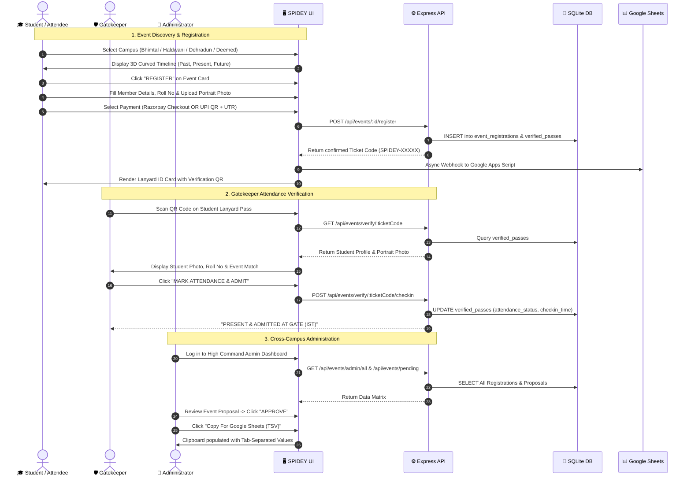

# 🕷️ SPIDEY: Graphic Era Quad-Campus Event Hub & Multiverse Student Platform

[](https://react.dev/)
[](https://vitejs.dev/)
[](https://tailwindcss.com/)
[](https://nodejs.org/)
[](https://expressjs.com/)
[](https://sql.js.org/)
[](https://developers.google.com/identity)
[](https://razorpay.com/)

**SPIDEY** (*Student Portal for Institutional Discovery, Events & Yardsticks*) is an all-in-one quad-campus event discovery, ticketing, attendance verification, and administrative platform engineered specifically for the **Graphic Era University** ecosystem in Uttarakhand, India. Built with a sleek Spider-Man multiverse aesthetic, the platform unifies four distinct campus branches into a synchronized digital grid:

1. **Graphic Era Hill University, Bhimtal Campus** (*High-Altitude Lake View Innovation & Tech Arena*)
2. **Graphic Era Hill University, Haldwani Campus** (*Gateway Cyber-Robotics, Design & Innovation Arena*)
3. **Graphic Era Hill University, Dehradun Campus** (*Hill University Flagship Center of Excellence*)
4. **Graphic Era Deemed to be University, Dehradun** (*NAAC A+ Accredited Multiverse Research Headquarters*)

Whether a student is registering solo or as a hackathon squad, downloading custom-branded lanyard ID passes with live QR verification, paying registration fees via Razorpay or direct UPI, or administrators are orchestrating cross-campus registrations into Google Sheets, SPIDEY delivers a zero-latency, high-performance web experience.

---

## 📑 Table of Contents

- [A. Project Title and Introduction](#️-spidey-graphic-era-quad-campus-event-hub--multiverse-student-platform)
- [B. Problem Statement](#-problem-statement)
- [C. Proposed Solution](#-proposed-solution)
- [D. Objectives](#-objectives)
- [E. Key Features](#-key-features)
- [F. Complete Technology Stack](#-complete-technology-stack)
- [G. System Architecture and Data Flow](#-system-architecture-and-data-flow)
- [H. Project Folder Structure](#-project-folder-structure)
- [I. Installation and Local Setup](#-installation-and-local-setup)
- [J. Environment Variables](#-environment-variables)
- [K. API Documentation](#-api-documentation)
- [L. Database Design](#-database-design)
- [M. User Workflow](#-user-workflow)
- [N. Screenshots and Media Assets](#-screenshots-and-media-assets)
- [O. Deployment Guide](#-deployment-guide)
- [P. Future Improvements](#-future-improvements)
- [Q. Contributing Guidelines](#-contributing-guidelines)
- [R. License and Acknowledgements](#-license-and-acknowledgements)

---

## 📌 Problem Statement

Graphic Era operates multiple flourishing campuses across Uttarakhand. Despite hosting high-impact national hackathons (Smart India Hackathon, Watch The Code), cultural mega-fests (Student Grafest), technical symposia (PRAYUKTI 2.0, INNOVATE 1.0 AWS Ideathon), and athletic championships, students and campus administrators face several critical operational bottlenecks:

1. **Campus Isolation & Fragmented Discovery**: Events organized at Bhimtal or Haldwani are frequently unnoticed by students in Dehradun, and vice-versa. There was no single pane of glass uniting all four campuses.
2. **Manual & Unverifiable Registration Forms**: Campus clubs relied on ad-hoc Google Forms, which lacked real-time seat limits, duplicate prevention, team composition controls, and automated ticket generation.
3. **Security Gate Bottlenecks**: Physical paper passes and PDF screenshots are easily forged, shared between unauthorized attendees, and slow for gatekeepers to verify during heavy entry rushes.
4. **Lost Institutional Memory**: Once flagship events conclude, high-resolution photographs, award records, and keynote highlights are scattered across individual personal phone drives and lost over time.
5. **Disconnected Fee Collection**: Managing event entry fees through disparate UPI screenshots required manual cross-referencing against bank accounts, leading to unverified or missing attendee records.

---

## 💡 Proposed Solution

SPIDEY solves these operational challenges by delivering an interconnected, high-tech event infrastructure:

- **3D Curved Campus Radar**: An interactive, touch-friendly 3D curved slider allowing students to glide between Bhimtal, Haldwani, Dehradun, and Deemed campuses, filtering event timelines into **Past**, **Present**, and **Future** automatically.
- **Executive Lanyard ID Passes with Live QR**: Generates print-ready student passes with portrait photos, University Roll Numbers, team credentials, and unique cryptographic ticket codes (`SPIDEY-XXXXX`, `HTW-2027`, `GRAFEST-XXXXX`).
- **Public Gatekeeper QR Verification Terminal**: A dedicated, mobile-optimized `/verify/:ticketCode` route allowing security personnel to scan student ID cards, view authentic student profile photos, and click to mark timestamped attendance in IST.
- **Concluded Event Photo Archives**: Deep historical archives with high-resolution photo galleries, modal lightboxes, celebration highlights, and video aerial surveillance for concluded festivals.
- **Dual Payment & UPI UTR Verification**: Integrated Razorpay Standard Checkout for credit/debit/netbanking alongside direct UPI QR payments (`chaudharyujjwal@fam`) validated with 12-digit bank UTR entry.
- **Two-Way Google Sheets Sync**: Live background webhooks pushing new attendee rows to Google Apps Script, coupled with one-click TSV clipboard copying for rapid administrative audits.
- **Training & Placement (T&P) Hub**: Centralized recruiter partner showcase and placed-student hall of fame with salary package tiers (Super Dream, Dream).

---

## 🎯 Objectives

- **Quad-Campus Centralization**: Unify all Graphic Era Hill University branches and Graphic Era Deemed University onto a single, cohesive digital portal.
- **Paperless & Secure Ticketing**: Eliminate physical event tickets in favor of secure, scannable QR passes tied to verified student roll numbers.
- **Instant Institutional Archiving**: Preserve campus milestones, winning hackathon teams, and cultural highlights with authentic event photography.
- **Streamlined Gate Operations**: Provide campus security personnel with an instant, zero-friction verification tool that logs entry times.
- **High-Performance Offline Resilience**: Provide comprehensive client-side fallback data ensuring the platform remains fully functional even when backend APIs or external networks experience latency.

---

## ⚡ Key Features

### 1. Quad-Campus Radar & Timeline Engine
- **3D Curved Carousel**: Smooth physics-based sliding between Bhimtal, Haldwani, Dehradun, and Deemed campuses with campus-specific neon theme accents.
- **Automated Date Partitioning**: Compares event dates dynamically against reference timelines to partition schedules into:
  - **Past Events & Concluded Archives**
  - **Present Day / Live Now**
  - **Upcoming Missions & Upcoming Announcements**
- **Google Calendar Web Intent**: One-click button on every event card pre-filling title, campus venue, timings, and attendee email into Google Calendar.

### 2. Multi-Step Event Registration Protocol
- **Participation Modes**: Toggle between **Solo Registration** and **Team Registration** (with configurable squad sizes from 2 to 6 members).
- **Attendee Detail & Photo Upload**: Each team member inputs their Full Name, University Roll Number, Degree/Course, Campus, Contact Number, and uploads a high-resolution portrait photo via `FileReader` data URLs.
- **Track Selection**: Customizable event tracks (AI/Machine Learning, Cloud & DevOps, Web3, Battle of Bands, Robowars, etc.).

### 3. Integrated Payment Gateways
- **Razorpay Standard Checkout**: Auto-triggers Razorpay checkout modal with cryptographic HMAC SHA-256 signature verification on the backend.
- **Direct UPI QR Engine**: Generates dynamic UPI intent QR codes payable to official university accounts (`chaudharyujjwal@fam`), supporting flexible test amounts (₹1, ₹10, or full fee).
- **12-Digit Bank UTR Verification**: Students input their bank transaction reference / UTR number for validation.

### 4. Executive Lanyard ID Passes & Digital Tickets
- **Snake Cascade & Grid Views**: Interactive preview of all team passes simultaneously.
- **Dynamic Verification QR Code**: High-density QR code rendered via `qrcode` pointing directly to `/verify?code=<ticketCode>&...`.
- **Card Utilities**: One-click download, single-card print, batch print, and social media sharing buttons (X/Twitter and LinkedIn).

### 5. Security Gatekeeper QR Attendance Terminal
- **Public Verification Route** (`/verify` and `/verify/:code`): Accessible on mobile browsers by campus security guards and event volunteers without requiring login credentials.
- **Photo Match & Credential Validation**: Displays the student's authentic uploaded photo, Roll No, Team Name, and Track.
- **Timestamped Check-In**: One-tap button marking `"PRESENT & VERIFIED"` with exact Indian Standard Time (IST) attendance logging.

### 6. Concluded Past Events & Photo Galleries
- **Responsive Photo Matrix**: Masonry-style image grids with hover zoom and photo index counters.
- **Fullscreen Lightbox**: Full-resolution image viewer with auto-playing slideshow mode and keyboard navigation (Left/Right arrows, Escape).
- **Festival Highlights & Tributes**: Structured highlights, winner announcements (e.g. *Team TECH4ALL at Watch The Code*), and closing tributes.
- **4K Upscaled Drone Surveillance Visualizer**: Embedded video player for aerial campus drone footage with 90° orientation rotation and fullscreen toggling.

### 7. Administrative High Command Dashboard
- **Live Google Sheets Spreadsheet Matrix**: Tabular overview of all quad-campus event attendees with real-time search, campus filtering, and team/solo filtering.
- **One-Click Google Sheets Export**: Copy pre-formatted Tab-Separated Values (TSV) directly to clipboard to paste into Google Sheets instantly.
- **Approval Queue**: Dedicated review screen to inspect organizer-submitted proposals and approve or reject with custom feedback.
- **Platform Analytics**: Total event count, pending approvals, approved archives, total RSVPs, and registered users.

### 8. Training & Placement (T&P) Intelligence
- **Recruiter Directory**: Interactive company cards (Google, Microsoft, Amazon, Adobe, TCS, Infosys, etc.) with CTC packages and hiring categories.
- **Placed Student Profiles**: Filterable by package tier (**Super Dream** $\ge$ ₹20 LPA, **Dream** $\ge$ ₹10 LPA) and campus branch.

### 9. Stark-Tech Multiverse Aesthetic & Transitions
- **Spider-Web Canvas Transitions**: Interactive canvas web-blast animations and sound effects (`thwip.mp3`) triggered during navigation.
- **Interactive Light Sensors**: Cursor-tracking spotlight sensors on campus leadership cards (Prof. Dr. Kamal Ghanshala and Campus Directors).
- **Cinematic Entry Modals**: First-visit intro video modal and audio-visual authentication transitions.

> **Feature Status Distinction:**
> - **Completed & Active**: All 9 feature suites listed above are fully implemented, verified, and operational in the repository.
> - **Planned / Future Roadmap**: Automated email delivery via SMTP/SendGrid, native mobile push notifications, and WebSockets live chat during hackathons.

---

## 💻 Complete Technology Stack

### Frontend Architecture
| Technology | Version | Purpose in Project |
|---|---|---|
| **React** | `^18.2.0` | Component-based UI library powering SPA views, modals, and reactive state |
| **Vite** | `^5.0.8` | Next-generation frontend tooling providing lightning-fast HMR and optimized builds |
| **React Router DOM** | `^6.21.1` | Declarative client-side routing, protected role routes, and parameterized URLs |
| **Tailwind CSS** | `^3.4.0` | Utility-first styling framework with custom Spider-Man theme colors and keyframes |
| **Axios** | `^1.6.2` | Promise-based HTTP client for backend REST API requests and authentication headers |
| **QRCode** | `^1.5.4` | Client-side QR code generation generating scannable pass verification URLs |
| **PostCSS & Autoprefixer**| `^8.4.32` / `^10.4.16` | CSS transformation and cross-browser vendor prefixing |

### Backend Architecture
| Technology | Version | Purpose in Project |
|---|---|---|
| **Node.js** | `>= 18.0.0` | JavaScript runtime environment executing backend services |
| **Express.js** | `^4.18.2` | Fast, minimalist web framework hosting REST endpoints and static assets |
| **CORS** | `^2.8.5` | Cross-Origin Resource Sharing middleware enabling secure frontend communication |
| **JSONWebToken (JWT)**| `^9.0.2` | Stateless bearer token generation and verification with 7-day expiration |
| **Bcrypt.js** | `^2.4.3` | Salted cryptographic password hashing for local user accounts |
| **Google Auth Library**| `^9.15.1` | Server-side verification of Google OAuth 2.0 ID tokens for secure Single Sign-On |
| **Node Crypto** | *Built-in* | HMAC SHA-256 generation for Razorpay signatures and secure buffer comparisons |

### Database & Storage
| Technology | Version | Purpose in Project |
|---|---|---|
| **sql.js** | `^1.9.0` | SQLite engine compiled to WebAssembly (pure JS), requiring zero native C++ build tools |
| **SQLite File Store** | *Binary snapshot* | Snapshot persistence to disk (`backend/geu_spider_events.db`) every 5s and on mutation |
| **LocalStorage / Memory**| *Browser Web API* | Client-side caching of verified passes, user tokens, and fallback configurations |

### Third-Party APIs & External Integrations
| Service | Integration Type | Function in SPIDEY |
|---|---|---|
| **Razorpay** | REST API & Checkout Modal | Secure order creation and payment verification |
| **Unified Payments Interface (UPI)** | Dynamic Intent QR URI | Direct zero-commission peer-to-merchant payment processing |
| **Google Identity Services** | OAuth 2.0 Client | Instant one-tap login for Graphic Era university Gmail accounts |
| **Google Calendar** | Web Intent URL (`render?action=TEMPLATE`) | Direct event scheduling with prefilled titles, venues, and descriptions |
| **Google Sheets & Apps Script**| Webhook (`POST`) & TSV Parsing | Automated live student registration row insertion into administrative spreadsheets |

### Deployment & Tooling
| Tool | Target | Configuration File |
|---|---|---|
| **Vercel** | Frontend SPA | `vercel.json` (root rewrite to `/frontend/index.html`) |
| **Windows Shell Script** | Local Launch | `start.bat` (concurrent backend and frontend launcher) |

---

## 🏗️ System Architecture and Data Flow

### Architecture Diagram

```mermaid
flowchart TD
    subgraph ClientLayer["🖥️ Frontend Client (React 18 + Vite SPA)"]
        UI["User Interface / Spider-Man HUD"]
        Router["React Router DOM (Protected Routes)"]
        State["Auth Context & Local State"]
        Fallback["fallbackData.js (Zero-Latency Offline Cache)"]
    end

    subgraph ServerLayer["⚙️ Backend Server (Express.js on Port 5000)"]
        Server["server.js (CORS & Body-Parser)"]
        AuthRoute["routes/auth.js (JWT & Google SSO)"]
        EventsRoute["routes/events.js (Quad-Campus Events)"]
        RegRoute["routes/registrations.js (Passes & Attendees)"]
        VerifyRoute["routes/registrations.js (/verify & /checkin)"]
        PayRoute["routes/payment.js (Razorpay & UTR Engine)"]
        RsvpRoute["routes/rsvp.js (Student Reminders)"]
    end

    subgraph DataLayer["💾 Data Persistence Layer"]
        SqlJs["sql.js WebAssembly SQLite Engine"]
        DbFile[("geu_spider_events.db (Disk Snapshot)")]
    end

    subgraph ExternalServices["🌐 External Cloud Services"]
        GoogleAuth["Google Identity OAuth 2.0 API"]
        RazorpayApi["Razorpay Payments API"]
        GoogleSheets["Google Apps Script Webhook / Sheets"]
        GoogleCal["Google Calendar Web Intent"]
    end

    %% Client Interactions
    UI --> Router
    Router --> State
    State -.-> Fallback
    State <-->|REST API Calls (Axios)| Server

    %% Server Routing
    Server --> AuthRoute
    Server --> EventsRoute
    Server --> RegRoute
    Server --> VerifyRoute
    Server --> PayRoute
    Server --> RsvpRoute

    %% Database Operations
    AuthRoute <--> SqlJs
    EventsRoute <--> SqlJs
    RegRoute <--> SqlJs
    VerifyRoute <--> SqlJs
    RsvpRoute <--> SqlJs
    SqlJs <-->|fs.writeFileSync| DbFile

    %% External Services
    AuthRoute <-->|verifyIdToken| GoogleAuth
    PayRoute <-->|createOrder & HMAC SHA-256| RazorpayApi
    RegRoute -.->|Async Row Webhook| GoogleSheets
    UI -.->|Calendar URL Intent| GoogleCal
```

### Data Flow Lifecycle

1. **Campus Filtering Flow**:
   - The user selects a campus tab (e.g. *Haldwani*) on `CurvedCampusSlider`.
   - The client filters events where `e.campus === activeCampus.name`.
   - Events are automatically sorted by `event_date` against `todayStr` into Past, Present, and Future.
2. **Registration & Pass Creation Flow**:
   - Student completes team details and uploads portrait photos.
   - Form posts to `/api/events/:id/register` (or stores in local cache).
   - Backend assigns unique cryptographic ticket codes (`SPIDEY-XXXXX`, `HTW-2027-XXXXX`).
   - `LanyardIDCard` renders scannable QR code pointing to `/verify?code=<ticketCode>`.
   - Pass row is pushed asynchronously to Google Sheets via Apps Script webhook.
3. **Gatekeeper Verification Flow**:
   - Security personnel at campus gates scan the attendee's QR pass using a mobile device.
   - The browser opens `/verify/:ticketCode`.
   - The backend checks `verified_passes` $\rightarrow$ `event_registrations` $\rightarrow$ `details_json`.
   - Guard views student's authentic photo and clicks **"MARK ATTENDANCE & ADMIT"**.
   - Attendance status updates to `"PRESENT & VERIFIED"` with exact IST check-in time.

---

## 📁 Project Folder Structure

```text
SPIDEY-main/
├── .env.example                     # Root environment configuration template
├── .gitignore                       # Git ignore patterns (node_modules, logs, etc.)
├── README.md                        # Primary project documentation
├── start.bat                        # Windows one-click dual server launcher
├── vercel.json                      # Vercel deployment SPA rewrite configuration
│
├── backend/                         # Express.js REST API Backend
│   ├── .env.example                 # Backend environment variable template
│   ├── db.js                        # sql.js SQLite initialization, schemas, and seed data
│   ├── geu_spider_events.db         # Persistent SQLite database binary file
│   ├── package.json                 # Backend dependencies and startup scripts
│   ├── package-lock.json            # Exact backend dependency tree lock
│   ├── server.js                    # Express server entry point, CORS, and route mounting
│   └── routes/                      # Modular REST API route handlers
│       ├── auth.js                  # Local JWT register/login and Google OAuth verification
│       ├── events.js                # Event CRUD, approval queue, campuses, and stats
│       ├── payment.js               # Razorpay order generation and HMAC verification
│       ├── registrations.js         # Event registration, pass generation, and QR verification
│       └── rsvp.js                  # Student RSVP toggles and reminder queue
│
└── frontend/                        # React 18 + Vite Single Page Application
    ├── index.html                   # HTML entry point with Google Fonts and meta tags
    ├── package.json                 # Frontend dependencies and Vite build scripts
    ├── package-lock.json            # Exact frontend dependency tree lock
    ├── postcss.config.js            # PostCSS configuration for Tailwind
    ├── tailwind.config.js           # Custom Spider-Man themes, colors, and keyframe animations
    ├── vite.config.js               # Vite bundler configuration and proxy rules
    │
    ├── public/                      # Static assets served at root path
    │   └── assets/                  # Authentic media files
    │       ├── logo.png             # Spider-Man Campus Hub logo
    │       ├── thwip.mp3            # Web shooter sound effect
    │       ├── campuses/            # 4K campus aerial photos (bhimtal, haldwani, dehradun, deemed)
    │       ├── leadership/          # Authentic photos of University President and Directors
    │       ├── videos/              # Campus drone footage and cinematic entry clips
    │       └── events/              # Authentic event photo archives
    │           ├── aws_ideathon/    # INNOVATE 1.0 AWS Ideathon photos (Bhimtal)
    │           ├── dussehra/        # Dussehra festival celebration photos (Bhimtal)
    │           ├── foundation_day/  # Silver Jubilee Foundation Day photos (Dehradun)
    │           ├── ganesh_chaturthi/# Ganesh Utsav celebration photos (Bhimtal)
    │           ├── grafest/         # Grafest cultural festival archives (Dehradun)
    │           ├── haldwani_grafest/# Student Grafest fireworks and concert photos (Haldwani)
    │           ├── prayukti/        # PRAYUKTI 2.0 Robowars and tech-fest photos (Bhimtal)
    │           ├── sih/             # Smart India Hackathon Grand Finale photos (Dehradun)
    │           ├── sports/          # Inter-campus athletics and cricket tournament photos
    │           ├── student_grafest/ # Student Grafest dance and music photos (Dehradun)
    │           └── upcoming/        # Clean promotional cards for upcoming hackathons & fests
    │
    └── src/                         # Application source code
        ├── main.jsx                 # React root renderer
        ├── App.jsx                  # Main router configuration and protected routes
        ├── index.css                # Global CSS styles, custom scrollbars, and keyframes
        │
        ├── components/              # Modular, reusable UI components
        │   ├── CampusLeadershipSection.jsx # Stark-Tech cursor-tracking leadership spotlight
        │   ├── CampusTimelineView.jsx      # Past, Present, and Future timeline renderer
        │   ├── CompanyLogo.jsx             # Tech recruiter SVG logos with fallbacks
        │   ├── CurvedCampusSlider.jsx      # 3D curved quad-campus carousel with touch gestures
        │   ├── EventCard.jsx               # Universal event card with hover-cycling preview
        │   ├── EventGalleryModal.jsx       # Event memories gallery modal with fullscreen lightbox
        │   ├── EventRegistrationModal.jsx  # Multi-step pass generator, photos, and payment
        │   ├── EventVideoModal.jsx         # Drone surveillance video player with rotation
        │   ├── IntroVideoModal.jsx         # First-visit cinematic intro video modal
        │   ├── Navbar.jsx                  # Navigation bar with role badges and web shooter triggers
        │   ├── ProtectedRoute.jsx          # Route guard checking authentication and roles
        │   ├── SigninVideoModal.jsx        # Login audio-visual feedback modal
        │   ├── SignoutVideoModal.jsx       # Logout audio-visual feedback modal
        │   └── WebShooterTransition.jsx   # Interactive canvas web blast animation
        │
        ├── context/
        │   └── AuthContext.jsx             # React Context for JWT auth and session storage
        │
        ├── data/
        │   └── fallbackData.js             # Comprehensive offline dataset for all 4 campuses
        │
        ├── pages/                          # Primary view controllers
        │   ├── AdminDashboard.jsx          # High Command dashboard, approvals, and Google Sheets matrix
        │   ├── Login.jsx                   # Spider-Man themed login with Google One-Tap
        │   ├── OrganizerDashboard.jsx      # Event dispatch and proposal submission console
        │   ├── Placement.jsx               # T&P recruitment portal, placed students, and analytics
        │   ├── Register.jsx                # New student and organizer account registration
        │   ├── StudentFeed.jsx             # Student quad-campus event radar and RSVP manager
        │   └── VerifyPass.jsx              # Mobile-friendly security gatekeeper QR pass verification
        │
        └── utils/
            ├── calendarUtils.js            # Google Calendar direct URL generator
            └── googleSheetsSync.js         # Google Apps Script webhook dispatcher & TSV exporter
```

---

## 🚀 Installation and Local Setup

Follow these verified steps to run the SPIDEY platform locally.

### 1. Prerequisites
- **Node.js**: Version 18.0.0 or higher ([Download Node.js](https://nodejs.org/))
- **npm**: Version 9.0.0 or higher (packaged with Node.js)
- **Git**: For repository cloning ([Download Git](https://git-scm.com/))

### 2. Clone the Repository
```bash
git clone https://github.com/ujjwalchaudharyyy/SPIDEY.git
cd SPIDEY
```

### 3. Quick Start (Windows Users)
You can launch both the backend and frontend simultaneously using the included batch script:
```cmd
start.bat
```
This opens two independent command prompt windows running the backend on port 5000 and the frontend on port 5173.

---

### 4. Manual Step-by-Step Setup

#### Step A: Configure Backend Server
1. Open a terminal and navigate to the `backend/` directory:
   ```bash
   cd backend
   ```
2. Install backend dependencies:
   ```bash
   npm install
   ```
3. Create your environment configuration file:
   ```bash
   cp .env.example .env
   ```
4. Start the backend server:
   ```bash
   npm start
   ```
   *The backend will initialize the SQLite database (`geu_spider_events.db`) and run at **http://localhost:5000**.*

#### Step B: Configure Frontend Application
1. Open a second terminal window and navigate to the `frontend/` directory:
   ```bash
   cd frontend
   ```
2. Install frontend dependencies:
   ```bash
   npm install
   ```
3. Start the Vite development server:
   ```bash
   npm run dev
   ```
   *The frontend application will compile and launch at **http://localhost:5173**.*

---

### 5. Verified Demo Credentials

The platform seeds default administrative and student credentials into SQLite on initialization:

| Role | Email Address | Password | Campus Access |
|---|---|---|---|
| **Super Admin (Head Admin)** | `admin@campus.edu` | `admin123` | Global (All 4 Campuses) |
| **Super Admin (Lead Developer)**| `ujjwalchaudhary2007@gmail.com` | *Via Google SSO* | Global (All 4 Campuses) |
| **Student** | Register via `/register` or Google SSO | *Custom* | Selected Campus |
| **Organizer** | Register via `/register` with Organizer role | *Custom* | Selected Campus |

---

## 🔐 Environment Variables

The project includes template environment variable files (`.env.example` at root and in `backend/`). Below is the complete specification:

| Variable Name | Required | Default / Example Value | Description |
|---|---|---|---|
| `PORT` | Optional | `5000` | Port on which the backend Express server listens |
| `JWT_SECRET` | **Required** | `campus_event_hub_secret_2024` | Secret cryptographic key used to sign and verify user JWTs |
| `GOOGLE_CLIENT_ID` | Optional | `your-google-client-id.apps.googleusercontent.com` | Google OAuth 2.0 Web Client ID for backend token validation |
| `VITE_GOOGLE_CLIENT_ID`| Optional | `your-google-client-id.apps.googleusercontent.com` | Google OAuth 2.0 Client ID exposed to the Vite frontend |
| `RAZORPAY_KEY_ID` | Optional | `rzp_test_YOUR_KEY_HERE` | Razorpay Key ID (supports test mode or live mode) |
| `RAZORPAY_KEY_SECRET` | Optional | `YOUR_KEY_SECRET_HERE` | Razorpay Secret Key used to calculate HMAC SHA-256 signatures |
| `RAZORPAY_WEBHOOK_SECRET`| Optional | `YOUR_WEBHOOK_SECRET_HERE` | Secret used to verify incoming Razorpay server webhooks |
| `FRONTEND_URL` | Optional | `http://localhost:5173` | Allowed CORS origin for production deployments |

> [!IMPORTANT]
> Never commit `.env` files containing real production keys or secrets to version control. Always keep them in `.gitignore`.

---

## 📡 API Documentation

All backend endpoints are prefixed with `/api`.

### 1. Authentication Endpoints (`/api/auth`)
- **`POST /api/auth/register`**
  - **Purpose**: Registers a new student or organizer.
  - **Body**: `{ "name": "...", "email": "...", "password": "...", "role": "student|organizer", "campus": "...", "phone": "...", "degree": "..." }`
  - **Response**: `{ "token": "...", "user": { ... } }` (`201 Created`)
- **`POST /api/auth/login`**
  - **Purpose**: Authenticates local credentials and issues a 7-day JWT.
  - **Body**: `{ "email": "...", "password": "..." }`
  - **Response**: `{ "token": "...", "user": { ... } }` (`200 OK`)
- **`POST /api/auth/google`**
  - **Purpose**: Verifies Google OAuth ID token, auto-provisions user, and issues JWT.
  - **Body**: `{ "token": "<Google_ID_Token>" }`
  - **Response**: `{ "token": "...", "user": { ... } }` (`200 OK`)
- **`GET /api/auth/me`**
  - **Purpose**: Returns the decoded profile of the authenticated user.
  - **Auth**: Bearer JWT required.

### 2. Events Endpoints (`/api/events`)
- **`GET /api/events`**
  - **Purpose**: Lists approved events with optional filtering.
  - **Query Parameters**: `campus` (*e.g. bhimtal*), `category` (*e.g. Technical*), `timeline` (*past|present|future*), `search`.
  - **Response**: Array of event objects with `rsvp_count`, parsed `gallery`, `photos`, and `highlights`.
- **`GET /api/events/campuses`**
  - **Purpose**: Returns metadata for the 4 Graphic Era campuses (colors, taglines, 4K images).
- **`GET /api/events/categories`**
  - **Purpose**: Returns the allowed category list.
- **`GET /api/events/pending`**
  - **Purpose**: Retrieves event proposals pending admin review.
  - **Auth**: Admin only.
- **`GET /api/events/my`**
  - **Purpose**: Lists events submitted by the authenticated organizer.
  - **Auth**: Organizer only.
- **`GET /api/events/stats`**
  - **Purpose**: Returns system-wide statistics (total events, pending, approved, RSVPs, users).
  - **Auth**: Admin only.
- **`POST /api/events/submit`**
  - **Purpose**: Submits a new event proposal to the admin queue.
  - **Auth**: Organizer only.
  - **Body**: `{ "title": "...", "description": "...", "category": "...", "venue": "...", "campus": "...", "event_date": "YYYY-MM-DD", "event_time": "HH:MM" }`
- **`PUT /api/events/:id/approve`**
  - **Purpose**: Approves a pending event proposal.
  - **Auth**: Admin only.
- **`PUT /api/events/:id/reject`**
  - **Purpose**: Rejects a pending proposal with explanation.
  - **Auth**: Admin only.
  - **Body**: `{ "reason": "..." }`
- **`DELETE /api/events/:id`**
  - **Purpose**: Retracts or removes an event.
  - **Auth**: Admin or the original event organizer.

### 3. Registration & Pass Endpoints (`/api/events`)
- **`POST /api/events/:id/register`**
  - **Purpose**: Registers a student/team for an event, generates ticket code, and seeds verified pass.
  - **Auth**: Student only.
  - **Body**: `{ "student_name": "...", "student_email": "...", "phone": "...", "roll_no": "...", "team_name": "...", "details_json": { "attendees": [...] } }`
- **`GET /api/events/registrations/my`**
  - **Purpose**: Lists registered events for the logged-in student.
  - **Auth**: Student only.
- **`GET /api/events/admin/all`**
  - **Purpose**: High Command view of all event registrations across all 4 campuses.
  - **Auth**: Super Admin only.
- **`GET /api/events/:id/attendees`**
  - **Purpose**: Event roster for organizers and admins.
  - **Auth**: Admin or event organizer.
- **`GET /api/events/verify/:ticketCode`**
  - **Purpose**: Public QR verification lookup returning attendee identity and verification status.
  - **Auth**: Public (zero login required for gatekeepers).
- **`POST /api/events/verify/:ticketCode/checkin`**
  - **Purpose**: Marks attendance status as `"PRESENT & VERIFIED"` with exact IST check-in time.
  - **Auth**: Public / Gatekeeper.
- **`POST /api/events/verify/save-passes`**
  - **Purpose**: Public bulk sync endpoint allowing frontend to persist attendee passes.

### 4. RSVP Endpoints (`/api/rsvp`)
- **`POST /api/rsvp/:eventId`**
  - **Purpose**: Toggles student RSVP status for an event.
  - **Auth**: Student only.
  - **Response**: `{ "rsvped": true|false, "rsvp_count": <number> }`
- **`GET /api/rsvp/my`**
  - **Purpose**: Returns all events marked by the student.
  - **Auth**: Student only.
- **`GET /api/rsvp/status/:eventId`**
  - **Purpose**: Checks if the current student has RSVPed for a specific event.

### 5. Payments Endpoints (`/api/payment` & `/api`)
- **`POST /api/payment/create-order`**
  - **Purpose**: Creates an official Razorpay order or in-memory fallback order.
  - **Body**: `{ "amount": 19900, "eventTitle": "...", "studentName": "...", "studentEmail": "..." }`
- **`POST /api/payment/verify-payment`**
  - **Purpose**: Validates Razorpay HMAC SHA-256 signature (`order_id|payment_id`).
  - **Body**: `{ "razorpay_order_id": "...", "razorpay_payment_id": "...", "razorpay_signature": "..." }`
- **`GET /api/payment/order-status?order_id=...`**
  - **Purpose**: Checks payment confirmation status for an order.

### 6. System Health (`/api/health`)
- **`GET /api/health`**
  - **Purpose**: Uptime probe returning server timestamp.

---

## 🗄️ Database Design

SPIDEY uses a pure JavaScript WebAssembly SQLite engine (`sql.js`) that persists binary database snapshots directly to disk at `backend/geu_spider_events.db`. The schema consists of five relational tables:

```text
+---------------------+       +-----------------------+       +-------------------------+
|        users        |       |        events         |       |   event_registrations   |
+---------------------+       +-----------------------+       +-------------------------+
| id (PK)             |<--+   | id (PK)               |<--+   | id (PK)                 |
| name                |   |   | title                 |   +---| event_id (FK)           |
| email (UNIQUE)      |   +---| organizer_id (FK)     |   +---| user_id (FK)            |
| password            |   |   | description           |   |   | student_name            |
| phone               |   |   | category              |   |   | student_email           |
| degree              |   |   | venue                 |   |   | phone                   |
| role                |   |   | campus                |   |   | degree                  |
| campus              |   |   | image_url             |   |   | roll_no                 |
| created_at          |   |   | photos (JSON)         |   |   | campus                  |
+---------------------+   |   | gallery (JSON)        |   |   | ticket_code (UNIQUE)    |
                          |   | highlights (JSON)     |   |   | team_name               |
                          |   | event_date            |   |   | team_size               |
                          |   | event_time            |   |   | track_info              |
                          |   | status                |   |   | details_json (JSON)     |
                          |   | rejection_reason      |   |   | created_at              |
                          |   | created_at            |   |   +-------------------------+
                          |   +-----------------------+   |
                          |               ^               |   +-------------------------+
                          |               |               |   |     verified_passes     |
                          |   +-----------+-----------+   |   +-------------------------+
                          |   |         rsvps         |   |   | ticket_code (PK)        |
                          |   +-----------------------+   |   | event_id                |
                          |   | id (PK)               |   |   | event_title             |
                          +---| user_id (FK)          |   |   | student_name            |
                              | event_id (FK)         |---+   | student_email           |
                              | reminded              |       | roll_no                 |
                              | created_at            |       | campus / degree         |
                              +-----------------------+       | team_name / role        |
                                                              | photo_url (Base64)      |
                                                              | attendance_status       |
                                                              | checkin_time            |
                                                              | created_at              |
                                                              +-------------------------+
```

### Table Definitions

1. **`users`**:
   - `id`: INTEGER PRIMARY KEY AUTOINCREMENT
   - `name`: TEXT NOT NULL
   - `email`: TEXT UNIQUE NOT NULL
   - `password`: TEXT NOT NULL (Bcrypt hash)
   - `phone` / `degree`: TEXT
   - `role`: TEXT CHECK(role IN ('student', 'organizer', 'admin'))
   - `campus`: TEXT NOT NULL DEFAULT 'GRAPHIC ERA HILL UNIVERSITY BHIMTAL'
   - `created_at`: DATETIME DEFAULT CURRENT_TIMESTAMP

2. **`events`**:
   - `id`: INTEGER PRIMARY KEY AUTOINCREMENT
   - `title`: TEXT NOT NULL
   - `description`: TEXT NOT NULL
   - `category`: TEXT NOT NULL
   - `venue` / `campus`: TEXT NOT NULL
   - `image_url` / `photos` (JSON) / `gallery` (JSON): TEXT
   - `winner_team` / `highlights` (JSON) / `overview` / `closing_message`: TEXT
   - `event_date` / `event_time` / `display_date`: TEXT NOT NULL
   - `organizer_id`: INTEGER (FOREIGN KEY $\rightarrow$ `users.id`)
   - `organizer_name`: TEXT NOT NULL
   - `status`: TEXT DEFAULT 'pending' CHECK(status IN ('pending', 'approved', 'rejected'))
   - `rejection_reason`: TEXT

3. **`rsvps`**:
   - `id`: INTEGER PRIMARY KEY AUTOINCREMENT
   - `user_id`: INTEGER (FOREIGN KEY $\rightarrow$ `users.id`)
   - `event_id`: INTEGER (FOREIGN KEY $\rightarrow$ `events.id`)
   - `reminded`: INTEGER DEFAULT 0
   - `created_at`: DATETIME
   - `UNIQUE(user_id, event_id)` prevents duplicate RSVPs.

4. **`event_registrations`**:
   - Full student event pass record storing `ticket_code`, `team_name`, `team_size`, `track_info`, `roll_no`, and serialized `details_json` containing individual team member objects.

5. **`verified_passes`**:
   - High-speed lookup table for security gate attendance scanning. Stores `ticket_code` as primary key, student portrait `photo_url`, `attendance_status` (e.g. *REGISTERED & VERIFIED* or *PRESENT & VERIFIED*), and IST `checkin_time`.

---

## 🔄 User Workflow



---

## 🖼️ Screenshots and Media Assets

All screenshots, diagrams, and photography referenced in SPIDEY are authentic assets stored directly in the repository:

### 1. Quad-Campus Visual Identifiers
- **Bhimtal Campus**: [`frontend/public/assets/campuses/bhimtal.png`](frontend/public/assets/campuses/bhimtal.png)
- **Haldwani Campus**: [`frontend/public/assets/campuses/haldwani.png`](frontend/public/assets/campuses/haldwani.png)
- **Dehradun Campus**: [`frontend/public/assets/campuses/dehradun.png`](frontend/public/assets/campuses/dehradun.png)
- **Deemed University**: [`frontend/public/assets/campuses/deemed.png`](frontend/public/assets/campuses/deemed.png)

### 2. Authentic Event Galleries
- **Smart India Hackathon (SIH 2026)**: [`frontend/public/assets/events/sih/`](frontend/public/assets/events/sih/)
- **Student Grafest (Haldwani Concert & Pyrotechnics)**: [`frontend/public/assets/events/haldwani_grafest/`](frontend/public/assets/events/haldwani_grafest/)
- **PRAYUKTI 2.0 (Robowars & Tech Fest)**: [`frontend/public/assets/events/prayukti/`](frontend/public/assets/events/prayukti/)
- **INNOVATE 1.0 (AWS Ideathon & Cloud Club)**: [`frontend/public/assets/events/aws_ideathon/`](frontend/public/assets/events/aws_ideathon/)
- **Watch The Code (National Hackathon)**: [`frontend/public/assets/events/watch_the_code_1.jpg`](frontend/public/assets/events/watch_the_code_1.jpg)
- **Ganesh Chaturthi Cultural Celebration**: [`frontend/public/assets/events/ganesh_chaturthi/`](frontend/public/assets/events/ganesh_chaturthi/)
- **Silver Jubilee Foundation Day**: [`frontend/public/assets/events/foundation_day/`](frontend/public/assets/events/foundation_day/)

### 3. Drone Surveillance & Media
- **Himalayan Web-Drone Surveillance Video**: [`frontend/public/assets/videos/web_drone.mp4`](frontend/public/assets/videos/web_drone.mp4)
- **First-Visit Intro Showcase**: [`frontend/public/assets/videos/before_login.mp4`](frontend/public/assets/videos/before_login.mp4)

---

## 🚢 Deployment Guide

### Vercel Deployment (Frontend Single Page Application)
The repository contains a pre-configured `vercel.json` rewrite:
```json
{
  "version": 2,
  "rewrites": [
    {
      "source": "/(.*)",
      "destination": "/frontend/index.html"
    }
  ]
}
```
1. Import the repository into **Vercel**.
2. Set the **Root Directory** to `frontend`.
3. Set **Framework Preset** to `Vite`.
4. Configure Environment Variables in Vercel settings:
   - `VITE_GOOGLE_CLIENT_ID`: Your Google OAuth Web Client ID.
5. Deploy. The application uses client-side routing and defaults to `fallbackData.js` if the backend API is operating in isolated mode.

### Production Node.js Server Deployment (Backend)
To deploy the backend to a VPS (Ubuntu/Debian), Render, Railway, or AWS EC2:
1. Ensure Node.js 18+ is installed on the host.
2. Clone the repository and navigate to `backend/`:
   ```bash
   cd backend
   npm install --production
   ```
3. Set production environment variables:
   ```bash
   export PORT=5000
   export JWT_SECRET="your-strong-production-jwt-secret"
   export FRONTEND_URL="https://your-frontend-domain.vercel.app"
   ```
4. Start with a process manager such as **PM2**:
   ```bash
   npm install -g pm2
   pm2 start server.js --name "spidey-backend"
   pm2 save
   pm2 startup
   ```

---

## 🔮 Future Improvements

The following items are identified for future platform iterations:

- [ ] **Automated Transactional Emails**: Integrating Nodemailer or SendGrid to dispatch high-resolution PDF lanyard tickets directly to student Gmail inboxes upon payment confirmation.
- [ ] **Native Mobile Gatekeeper App**: A lightweight React Native companion application utilizing device cameras for continuous, high-speed barcode/QR stream scanning at security turnstiles.
- [ ] **Real-Time WebSockets**: Live announcements and team collaboration channels during 24-hour hackathons.
- [ ] **Certificate Generation**: Automated issuance of digitally verifiable participation and winner certificates for concluded events.

---

## 🤝 Contributing Guidelines

Contributions from Graphic Era students, faculty coordinators, and open-source developers are warmly welcomed.

1. **Fork the Repository**:
   Click the **Fork** button at the top right of [`https://github.com/ujjwalchaudharyyy/SPIDEY`](https://github.com/ujjwalchaudharyyy/SPIDEY).
2. **Create a Feature Branch**:
   ```bash
   git checkout -b feature/amazing-feature
   ```
3. **Commit Your Changes**:
   Follow conventional commits:
   ```bash
   git commit -m "feat: implement certificate generation modal"
   ```
4. **Push to Your Branch**:
   ```bash
   git push origin feature/amazing-feature
   ```
5. **Open a Pull Request**:
   Submit your pull request against the `main` branch with a clear description of the modifications.

---

## 📜 License and Acknowledgements

### License
This project is an institutional and academic software platform developed for the **Graphic Era University** community. All rights are reserved by the original project contributors and student developers (`ujjwalchaudharyyy`, `Tushar_Gahlout`, `Sumit Sanwal`, `Sapna Bisht`). Reuse for educational, evaluation, and hackathon demonstration purposes is permitted.

### Acknowledgements
- **Graphic Era Educational Society**: Special gratitude to the visionary leadership of **Prof. (Dr.) Kamal Ghanshala** (Founder & President) and the Campus Directors of Bhimtal, Haldwani, Dehradun, and Deemed campuses.
- **Student Activity Councils & Clubs**: Student Activity Council (SAC), IEEE Student Branch, Aero-Spidey Club, and the AWS Cloud Club (GEHU BTL) for authentic event media and collaboration.
- **Open-Source Community**: Sincere thanks to the creators of `sql.js`, `React`, `Vite`, `Tailwind CSS`, and `Express.js`.

---

<div align="center">
  <sub>Built with 🕷️ Spidey-Sense & Pride for Graphic Era Hill University & Graphic Era Deemed University.</sub>
</div>
