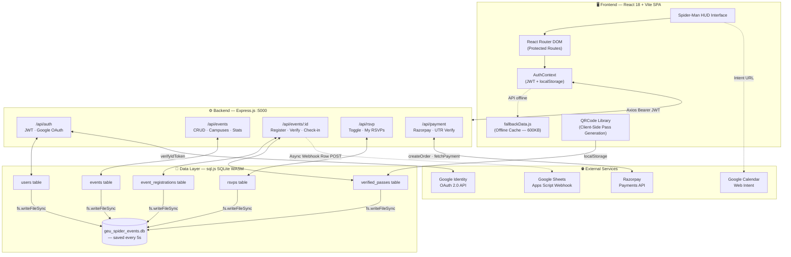
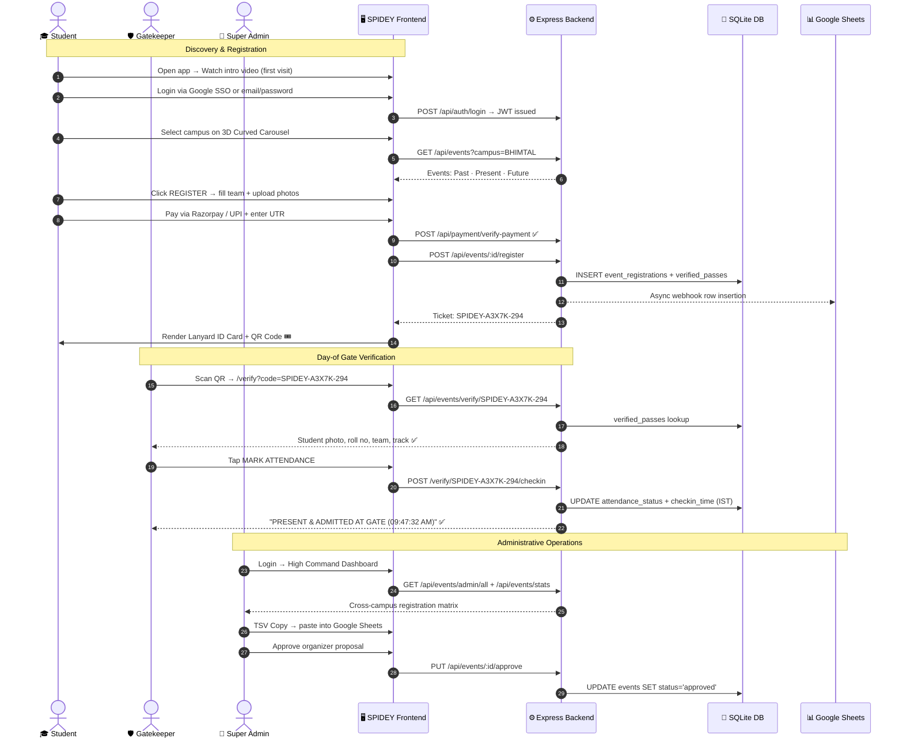

<div align="center">

<!-- ═══════════════════════════ HERO BANNER ═══════════════════════════ -->


# 🕷️ SPIDEY

### *Student Portal for Institutional Discovery, Events & Yardsticks*

> **"With great events, comes great responsibility."**

<br/>

[](https://react.dev/)
[](https://vitejs.dev/)
[](https://tailwindcss.com/)
[](https://nodejs.org/)
[](https://expressjs.com/)
[](https://sql.js.org/)

<br/>

[](https://developers.google.com/identity)
[](https://razorpay.com/)
[](https://www.npci.org.in/)
[](https://workspace.google.com/)
[](https://vercel.com/)
[](https://github.com/ujjwalchaudharyyy/SPIDEY)
[](https://github.com/ujjwalchaudharyyy/SPIDEY/pulls)

<br/>

[🚀 Quick Start](#-installation-and-local-setup) &nbsp;·&nbsp;
[📡 API Docs](#-api-documentation) &nbsp;·&nbsp;
[📐 Architecture](#-system-architecture-and-data-flow) &nbsp;·&nbsp;
[📸 Screenshots](#-platform-screenshots) &nbsp;·&nbsp;
[🤝 Contribute](#-contributing-guidelines)

</div>

---

<!-- ══════════════════════ CAMPUS RADAR SCREENSHOT ══════════════════════ -->

<div align="center">

## 🌐 Quad-Campus Event Hub — One Platform, Four Campuses


*The SPIDEY 3D Curved Campus Radar — glide between all four Graphic Era campuses with a single swipe*

</div>

<br/>

**SPIDEY** (*Student Portal for Institutional Discovery, Events & Yardsticks*) is a full-stack, Spider-Man multiverse–themed campus event platform built exclusively for the **Graphic Era University** group of institutions in Uttarakhand, India.

It replaces scattered Google Forms, paper entry passes, and WhatsApp announcements with a secure, professional, and visually stunning web application — unifying **four campuses** under one digital grid.

<div align="center">

|  | 🏔️ Bhimtal | ⚡ Haldwani | 🏛️ Dehradun | 🎓 Deemed |
|:---:|:---:|:---:|:---:|:---:|
| **Full Name** | GEHU Bhimtal | GEHU Haldwani | GEHU Dehradun | Graphic Era Deemed University |
| **Theme** | High-Altitude Lake View Innovation | Gateway Cyber-Robotics & Design | Flagship Centre of Excellence | NAAC A+ Research HQ |
| **Neon Accent** | 🔴 `#E21B24` Red | 🔵 `#0F52BA` Blue | 🟡 `#FFD700` Gold | 🩵 `#00F0FF` Cyan |

</div>

---

## 📑 Table of Contents

| # | Section |
|---|---|
| A | [Problem Statement](#-problem-statement) |
| B | [Proposed Solution](#-proposed-solution) |
| C | [Objectives](#-objectives) |
| D | [Platform Screenshots](#-platform-screenshots) |
| E | [Key Features](#-key-features) |
| F | [Real Event Archives](#-real-event-archives-from-campus) |
| G | [Technology Stack](#-complete-technology-stack) |
| H | [System Architecture](#-system-architecture-and-data-flow) |
| I | [Project Folder Structure](#-project-folder-structure) |
| J | [Installation & Setup](#-installation-and-local-setup) |
| K | [Environment Variables](#-environment-variables) |
| L | [API Documentation](#-api-documentation) |
| M | [Database Design](#-database-design) |
| N | [User Workflow](#-user-workflow) |
| O | [Deployment Guide](#-deployment-guide) |
| P | [Future Improvements](#-future-improvements) |
| Q | [Contributing Guidelines](#-contributing-guidelines) |
| R | [License & Acknowledgements](#-license-and-acknowledgements) |

---

## 📌 Problem Statement

Graphic Era runs multiple thriving campuses simultaneously. Despite hosting national hackathons, cultural mega-fests, technical symposia, and athletic championships — the infrastructure for event discovery, registration, and attendance was dangerously fragmented:

| ❌ Problem | 💢 Impact |
|---|---|
| **Campus Isolation** — events at Bhimtal go unnoticed in Dehradun | Low cross-campus participation and wasted opportunities |
| **Ad-hoc Google Forms** — no duplicate prevention, no team controls | Organizer overload, manual Excel cleanup after every event |
| **Paper / PDF Passes** — easily forged, slow to verify at gates | Security loopholes, long queues, unauthorized entries |
| **No Institutional Memory** — photos lost on personal phone drives | Campus legacy and achievements vanish over time |
| **Disconnected Fee Collection** — UPI screenshot matching manually | Payment disputes, unverified attendees, financial chaos |
| **No Placement Portal** — T&P data scattered across departments | Students unaware of active recruiters and placed alumni |

---

## 💡 Proposed Solution

```
┌─────────────────────────────────────────────────────────────────────┐
│  📡 3D Curved Quad-Campus Radar                                     │
│     → Physics-based carousel across all 4 campuses                  │
│     → Auto-sorts events into Past · Present · Future timelines       │
├─────────────────────────────────────────────────────────────────────┤
│  📝 Multi-Step Team Registration Protocol                           │
│     → Solo & squad modes (up to 6 members) with track selection     │
│     → Portrait photo upload per team member via FileReader           │
├─────────────────────────────────────────────────────────────────────┤
│  💳 Dual Payment Engine                                             │
│     → Razorpay Standard Checkout + HMAC SHA-256 order verification  │
│     → Direct UPI QR generation + 12-digit UTR bank validation       │
├─────────────────────────────────────────────────────────────────────┤
│  🪪 Executive Lanyard ID Card Generator                             │
│     → University-branded pass with portrait, roll no & QR           │
│     → Download PNG · Print · Share on X / LinkedIn                  │
├─────────────────────────────────────────────────────────────────────┤
│  🛡️ Mobile QR Gatekeeper Verification Terminal                      │
│     → Public /verify route — no login needed for gate staff         │
│     → IST timestamp-logged attendance marking                       │
├─────────────────────────────────────────────────────────────────────┤
│  📸 Past Event Photo Galleries & Drone Video Archives               │
│     → Fullscreen lightbox · Auto-slideshow · Keyboard navigation    │
│     → 4K drone surveillance video player with rotation              │
├─────────────────────────────────────────────────────────────────────┤
│  👑 Admin High Command Dashboard                                    │
│     → Live Google Sheets matrix · TSV export · Approvals queue      │
│     → Cross-campus analytics and real-time registration management  │
├─────────────────────────────────────────────────────────────────────┤
│  🏢 Training & Placement (T&P) Intelligence Hub                     │
│     → Recruiter directory · Placed student hall of fame             │
│     → Super Dream (≥₹20 LPA) / Dream (≥₹10 LPA) tier filtering    │
└─────────────────────────────────────────────────────────────────────┘
```

---

## 🎯 Objectives

- 🏫 **Quad-Campus Centralization** — one unified portal for all four Graphic Era institutions
- 🎟️ **Paperless Secure Ticketing** — cryptographic QR passes tied to verified student roll numbers
- 📸 **Institutional Memory Preservation** — high-res archives of every past event
- 🛡️ **Streamlined Gate Operations** — IST-timestamped attendance marking in one tap
- 📴 **Offline Resilience** — `fallbackData.js` (600KB) keeps the platform functional without a live backend
- 💰 **Integrated Fee Collection** — end-to-end Razorpay + UPI payment traceability
- 📊 **Data-Driven Administration** — real-time Google Sheets sync and cross-campus analytics

---

## 📸 Platform Screenshots

<div align="center">

### 🌐 Campus Radar — 3D Curved Carousel


> *Physics-based sliding between Bhimtal 🔴, Haldwani 🔵, Dehradun 🟡, and Deemed 🩵 — each with campus-specific neon accents and aerial photography*

---

### 📝 Multi-Step Event Registration with Team Builder


> *Configurable team size (2–6 members), per-member portrait upload, track selection, and dual payment options — all in one seamless form*

---

### 🪪 Executive Lanyard ID Pass Generator


> *University-branded event passes with student portrait, roll number, team details, and cryptographic QR ticket codes — downloadable, printable & shareable*

---

### 👑 Admin High Command Dashboard


> *Real-time cross-campus registration matrix with stats, Google Sheets export, and approval queue — accessible only to super admins*

---

### 🛡️ Gatekeeper QR Verification Terminal


> *Mobile-optimized gate terminal — security staff scan any student QR, see authentic portrait & details, and mark IST-timestamped attendance in one tap*

</div>

---

## ⚡ Key Features

<details>
<summary><b>🌐 1. Quad-Campus Radar & Timeline Engine</b></summary>
<br/>

- **3D Curved Carousel** (`CurvedCampusSlider.jsx`) — smooth physics-based sliding between all four campuses with campus-specific neon glow accents
- **Cursor-Tracking Spotlight Cards** (`CampusLeadershipSection.jsx`) — Stark-Tech spotlight effect on leadership portraits, following mouse position in real time
- **Automated Date Partitioning** (`CampusTimelineView.jsx`) — dynamically classifies every event into Past / Present / Future
- **Google Calendar Web Intent** — every event card pre-fills title, venue, timings, and description into Google Calendar with a single click
- **Campus-Scoped Filtering** — campus selection propagates through all components ensuring students only see their campus events

</details>

<details>
<summary><b>📝 2. Multi-Step Event Registration Protocol</b></summary>
<br/>

- **Participation Modes** — toggle between **Solo Registration** and **Team Registration** (2–6 members)
- **Per-Member Portrait Upload** — each team member uploads a JPEG/PNG photo via `FileReader` stored as Base64 data URLs
- **Dynamic Team Slots** — adding/removing members auto-generates placeholder names and roll numbers
- **Event Track Selection** — AI/ML, Cloud & DevOps, Web3, Battle of Bands, Robowars, Athletics, and more
- **Registration Isolation** — modal traps body scroll and keyboard focus during form completion

</details>

<details>
<summary><b>💳 3. Integrated Dual Payment Gateways</b></summary>
<br/>

- **Razorpay Standard Checkout** — triggers native Razorpay modal with HMAC SHA-256 `order_id|payment_id` backend verification
- **Direct UPI QR Engine** — client-side QR rendered for `chaudharyujjwal@fam` with dynamic INR amount
- **12-Digit Bank UTR Validation** — student pastes bank UTR; validated against Razorpay `fetchPayment()` API
- **Auto Fee Calculation** — ₹199 per member; 3-member team = ₹597 calculated automatically

</details>

<details>
<summary><b>🪪 4. Executive Lanyard ID Pass Generator</b></summary>
<br/>

- **Snake Cascade & Grid Views** — all team passes simultaneously displayed in a waterfall cascade
- **Cryptographic Ticket Codes** — unique auto-assigned IDs: `SPIDEY-XXXXX`, `HTW-2027-XXXXX`, `GRAFEST-XXXXX`
- **High-Density QR Code** — rendered via `qrcode` library, encodes full verification URL with ticket code, name, roll, campus, and role
- **Card Actions** — ⬇ Download PNG · 🖨 Print Single · 🖨 Batch Print All · ✕ Share on X · 🔗 Share on LinkedIn
- **localStorage Sync** — pass data saved for offline photo retrieval at gates

</details>

<details>
<summary><b>🛡️ 5. Security Gatekeeper QR Verification Terminal</b></summary>
<br/>

- **Zero-Login Public Route** — `/verify` and `/verify/:code` work on any mobile browser, no credentials required
- **3-Layer Pass Lookup** — checks `verified_passes` → `event_registrations` → `details_json` nested attendee arrays
- **Photo Match Display** — shows student's uploaded portrait alongside Roll No, Campus, Degree, Team, and Track
- **Timestamped Check-In** — one-tap marks `"PRESENT & ADMITTED AT GATE (HH:MM:SS AM/PM)"` in IST
- **Manual Code Fallback** — text input if QR camera scan fails

</details>

<details>
<summary><b>📸 6. Past Event Photo Galleries & Video Archives</b></summary>
<br/>

- **Responsive Photo Grid** — 1/2/3 column masonry layouts with hover-zoom and `#N` photo index badges
- **Fullscreen Lightbox** — auto-play slideshow (2.8s interval), touch-swipe, keyboard arrows (← →), Escape to close
- **Festival Highlights Panel** — winner announcements, event overviews, and closing tribute banners
- **4K Drone Video Player** — `EventVideoModal.jsx` with 90° orientation rotation, fullscreen API, and volume controls
- **Runtime Gallery Upload** — add extra event photos from local device during the session

</details>

<details>
<summary><b>👑 7. Administrative High Command Dashboard</b></summary>
<br/>

- **Role Separation** — super admin (`ujjwalchaudhary2007@gmail.com`) sees all 4 campuses; campus admins see their own
- **Registration Matrix** — searchable, filterable attendee table across all events and campuses
- **Google Sheets Integration** — per-event sheet URL + Apps Script webhook; one-click TSV clipboard export
- **Approval Queue** — inspect organizer proposals and approve / reject with custom feedback
- **Platform Statistics** — total events, pending approvals, approved archives, total RSVPs, registered users

</details>

<details>
<summary><b>🏢 8. Training & Placement (T&P) Intelligence Hub</b></summary>
<br/>

- **Recruiter Directory** — interactive company cards with logos (Google, Microsoft, Amazon, Adobe, TCS, Infosys…) and CTC packages
- **Placed Student Hall of Fame** — filterable by 🌟 **Super Dream** (≥ ₹20 LPA) and ⭐ **Dream** (≥ ₹10 LPA)
- **Multi-Campus Filter** — browse placements specifically for Bhimtal, Haldwani, Dehradun, or Deemed
- **Analytics Tab** — campus-wise placement statistics and company hiring breakdowns

</details>

<details>
<summary><b>🕷️ 9. Stark-Tech Multiverse Aesthetic</b></summary>
<br/>

- **Spider-Web Canvas Transitions** — SVG web-blast animations and `thwip.mp3` sound at every major navigation
- **Cinematic First-Visit Intro** — `before_login.mp4` plays automatically once per session, gated by `sessionStorage`
- **Sign-In / Sign-Out Video Modals** — custom cinematic transitions on authentication events
- **Custom Font Suite** — Chakra Petch (headers), Orbitron (stats/numbers), Rajdhani (body), JetBrains Mono (terminal)
- **Campus-Specific Neon Accents** — each campus has its own border glow, badge colour, and shadow applied consistently

</details>

> [!NOTE]
> **All 9 feature suites are fully implemented and verified in the repository.** Roadmap items (email delivery, native mobile, WebSocket chat) are clearly marked in [Future Improvements](#-future-improvements).

---

## 📸 Real Event Archives from Campus

All photos below are **authentic** — shot at actual Graphic Era University events by students and campus photography teams.

<div align="center">

### 🤖 Smart India Hackathon 2026 Grand Finale

| | | |
|:---:|:---:|:---:|
|  |  |  |
| *Grand Inauguration* | *Coding Sprint* | *Final Presentations* |

---

### 🎵 Student Grafest — Haldwani Campus (Live Concerts & Cultural Fest)

| | | |
|:---:|:---:|:---:|
|  |  |  |
| *Live Stage Performance* | *Dance Showcase* | *Student Celebrations* |

---

### ☁️ INNOVATE 1.0 — AWS Ideathon (Bhimtal Campus)

| | | |
|:---:|:---:|:---:|
|  |  |  |
| *Official Event Poster* | *Team Discussions* | *Venue & Crowd* |

---

### 🏆 Watch The Code — National Hackathon (Haldwani)

| | | |
|:---:|:---:|:---:|
|  |  |  |
| *Hackathon Sprint* | *Stage Ceremony* | *Winners' Trophy* |

---

### 🎭 Graphite Live — Cultural Extravaganza

| | | |
|:---:|:---:|:---:|
|  |  |  |
| *Opening Act* | *Band Performance* | *Crowd Energy* |

</div>

---

## 💻 Complete Technology Stack

### 🖥️ Frontend
| Technology | Version | Role |
|---|---|---|
| **React** | `^18.2.0` | Component-based SPA framework |
| **Vite** | `^5.0.8` | Build tool with instant HMR |
| **React Router DOM** | `^6.21.1` | Client-side routing & protected routes |
| **Tailwind CSS** | `^3.4.0` | Utility-first CSS + custom Spider-Man theme |
| **Axios** | `^1.6.2` | HTTP client for REST API communication |
| **QRCode** | `^1.5.4` | Client-side QR code generation |
| **PostCSS** | `^8.4.32` | CSS transformation pipeline |
| **Autoprefixer** | `^10.4.16` | Cross-browser vendor prefix injection |

### ⚙️ Backend
| Technology | Version | Role |
|---|---|---|
| **Node.js** | `≥ 18.0.0` | Server runtime environment |
| **Express.js** | `^4.18.2` | REST API server & static file serving |
| **CORS** | `^2.8.5` | Cross-origin resource sharing middleware |
| **jsonwebtoken** | `^9.0.2` | JWT generation & 7-day token verification |
| **bcryptjs** | `^2.4.3` | Salted password hashing (10 rounds) |
| **google-auth-library** | `^9.15.1` | Google OAuth 2.0 ID token verification |
| **Node `crypto`** | *(built-in)* | HMAC SHA-256 for Razorpay signatures |

### 💾 Database & Persistence
| Technology | Version | Role |
|---|---|---|
| **sql.js** | `^1.9.0` | SQLite compiled to WebAssembly — zero native deps |
| **SQLite file store** | *(binary)* | Disk snapshot every 5s → `geu_spider_events.db` |
| **Browser LocalStorage** | *(Web API)* | JWT session, verified passes, Google Sheets config |
| **SessionStorage** | *(Web API)* | Intro video seen flag (prevents replay on refresh) |

### 🌐 Third-Party Integrations
| Service | Integration Type | Purpose |
|---|---|---|
| **Razorpay** | REST API + JS SDK | Payment order creation & HMAC verification |
| **UPI / NPCI** | Intent QR URI | Direct peer-to-merchant payment |
| **Google Identity** | OAuth 2.0 | One-tap SSO login |
| **Google Calendar** | Web Intent URL | Pre-filled event scheduling |
| **Google Sheets** | Apps Script Webhook | Live attendee row insertion |

### 🚀 DevOps & Tooling
| Tool | Purpose |
|---|---|
| **Vercel** | Frontend SPA hosting with SPA rewrite rules |
| **PM2** | Node.js production process manager |
| **`start.bat`** | Windows one-click dual-server launcher |
| **Git + GitHub** | Version control (`ujjwalchaudharyyy/SPIDEY`) |

---

## 🏗️ System Architecture and Data Flow



### Key Data Flows

**1. Campus Selection → Event Timeline**
```
User taps campus tab (Bhimtal / Haldwani / Dehradun / Deemed)
  → activeCampusIndex updates in StudentFeed.jsx
  → currentCampusEvents = events.filter(e => e.campus === activeCampus.name)
  → CampusTimelineView sorts by event_date vs todayStr ('2026-10-27')
  → Past ·  Present · Future sections auto-render
```

**2. Registration → Pass → Gate Check-In**
```
Student fills multi-step form + uploads portraits + pays
  → POST /api/events/:id/register
  → Backend generates SPIDEY-XXXXX ticket code
  → INSERT into event_registrations + verified_passes
  → Async POST to Google Sheets webhook
  → LanyardIDCard renders QR → /verify?code=SPIDEY-XXXXX
  → Gatekeeper scans QR → GET /api/events/verify/SPIDEY-XXXXX
  → verified_passes lookup → display student portrait
  → POST /verify/:code/checkin → mark PRESENT (IST timestamp)
```

**3. Payment Flow**
```
Student selects Razorpay
  → POST /api/payment/create-order → Razorpay SDK modal
  → Student pays → POST /api/payment/verify-payment
  → Backend HMAC SHA-256 check → confirmed
  → Advance to ID card generation step ✅

Student selects UPI QR
  → Client generates UPI QR code → student pays via any UPI app
  → Student enters 12-digit UTR reference
  → UTR checked against Razorpay fetchPayment() → confirmed ✅
```

---

## 📁 Project Folder Structure

```
SPIDEY/
├── 📄 README.md                      ← You are here
├── 🪟 start.bat                      ← Windows one-click dual server launcher
├── 📄 vercel.json                    ← Vercel SPA rewrite config
├── 📄 .gitignore
│
├── ⚙️ backend/
│   ├── 📄 server.js                  ← Entry: CORS, body parser, route mounts
│   ├── 📄 db.js                      ← sql.js init, 5-table schema, 36+ seed events
│   ├── 🗄️ geu_spider_events.db      ← SQLite binary (auto-created on first run)
│   ├── 📄 package.json
│   └── 📂 routes/
│       ├── 📄 auth.js                ← Register, login, Google OAuth, /me
│       ├── 📄 events.js              ← Event CRUD, campuses, approval, stats
│       ├── 📄 registrations.js       ← Register, verify/:code, check-in, attendees
│       ├── 📄 rsvp.js                ← Toggle RSVP, my RSVPs, RSVP status
│       └── 📄 payment.js             ← Razorpay order, verify, order-status
│
└── 🖥️ frontend/
    ├── 📄 index.html                 ← HTML shell with Google Fonts CDN
    ├── 📄 vite.config.js             ← Vite bundler + dev proxy to :5000
    ├── 📄 tailwind.config.js         ← Custom Spider-Man colors, shadows & keyframes
    ├── 📄 package.json
    │
    ├── 📂 public/assets/
    │   ├── 🖼️ logo.png / spiderman_*.png
    │   ├── 🔊 thwip.mp3              ← Web-shooter sound effect
    │   ├── 📸 screenshots/           ← Platform UI screenshots (README media)
    │   ├── 📂 campuses/              ← 4K aerial photos (bhimtal/haldwani/dehradun/deemed)
    │   ├── 📂 leadership/            ← Chairman + campus directors portraits
    │   ├── 📂 videos/                ← Drone footage + login/logout cinematic clips
    │   └── 📂 events/
    │       ├── 📂 aws_ideathon/      ← INNOVATE 1.0 – AWS Ideathon (Bhimtal)
    │       ├── 📂 ganesh_chaturthi/  ← Ganesh Chaturthi (Bhimtal)
    │       ├── 📂 prayukti/          ← PRAYUKTI 2.0 Tech Fest (Bhimtal)
    │       ├── 📂 dussehra/          ← Dussehra Festival (Bhimtal)
    │       ├── 📂 sih/               ← Smart India Hackathon Grand Finale
    │       ├── 📂 grafest/           ← Student GRAFEST (Dehradun)
    │       ├── 📂 student_grafest/   ← Student Grafest Cultural (Dehradun)
    │       ├── 📂 haldwani_grafest/  ← Student Grafest Concerts (Haldwani)
    │       ├── 📂 foundation_day/    ← Silver Jubilee Foundation Day
    │       └── 📂 upcoming/          ← Promotional cards for future events
    │
    └── 📂 src/
        ├── 📄 main.jsx               ← React root renderer
        ├── 📄 App.jsx                ← Router config + protected route declarations
        ├── 📄 index.css              ← Global styles, custom scrollbars, spider keyframes
        │
        ├── 📂 components/
        │   ├── 🧩 CurvedCampusSlider.jsx       ← 3D curved quad-campus carousel
        │   ├── 🧩 CampusTimelineView.jsx        ← Past / Present / Future partitioner
        │   ├── 🧩 CampusLeadershipSection.jsx   ← Cursor-tracking spotlight cards
        │   ├── 🧩 EventCard.jsx                 ← Universal event preview card
        │   ├── 🧩 EventGalleryModal.jsx         ← Photo gallery + fullscreen lightbox
        │   ├── 🧩 EventRegistrationModal.jsx    ← Multi-step registration + payment
        │   ├── 🧩 EventVideoModal.jsx           ← Drone video player + rotation
        │   ├── 🧩 IntroVideoModal.jsx           ← First-visit cinematic intro
        │   ├── 🧩 SigninVideoModal.jsx          ← Login transition
        │   ├── 🧩 SignoutVideoModal.jsx         ← Logout transition
        │   ├── 🧩 WebShooterTransition.jsx      ← Canvas web-blast SVG animation
        │   ├── 🧩 Navbar.jsx                    ← Nav bar with role badges
        │   └── 🧩 ProtectedRoute.jsx            ← JWT role-based route guard
        │
        ├── 📂 context/
        │   └── 📄 AuthContext.jsx    ← React Context: JWT decode, login, logout
        │
        ├── 📂 data/
        │   └── 📄 fallbackData.js    ← 600KB offline dataset (36+ events, 4 campuses)
        │
        ├── 📂 pages/
        │   ├── 📄 Login.jsx          ← Spider-Man login + Google One-Tap SSO
        │   ├── 📄 Register.jsx       ← Campus-aware account creation
        │   ├── 📄 StudentFeed.jsx    ← Main campus radar + RSVP manager
        │   ├── 📄 OrganizerDashboard.jsx ← Event proposal console
        │   ├── 📄 AdminDashboard.jsx ← High Command: approvals, sheets, analytics
        │   ├── 📄 Placement.jsx      ← T&P recruiter + placed student portal
        │   └── 📄 VerifyPass.jsx     ← Gatekeeper QR verification terminal
        │
        └── 📂 utils/
            ├── 📄 calendarUtils.js   ← Google Calendar intent URL generator
            └── 📄 googleSheetsSync.js ← Apps Script webhook + TSV clipboard export
```

---

## 🚀 Installation and Local Setup

### Prerequisites

| Requirement | Minimum | Check |
|---|---|---|
| **Node.js** | v18.0.0 | `node --version` |
| **npm** | v9.0.0 | `npm --version` |
| **Git** | Any | `git --version` |

### Option A — One-Click (Windows)

```cmd
git clone https://github.com/ujjwalchaudharyyy/SPIDEY.git
cd SPIDEY
start.bat
```

> Opens two terminals automatically — backend on **:5000**, frontend on **:5173**

### Option B — Manual (All Platforms)

**Terminal 1 — Backend**
```bash
git clone https://github.com/ujjwalchaudharyyy/SPIDEY.git
cd SPIDEY/backend
npm install
cp .env.example .env          # Edit .env with your secrets
npm start
# ✅  Express API running at http://localhost:5000
# ✅  SQLite database auto-initialized (geu_spider_events.db)
```

**Terminal 2 — Frontend**
```bash
cd SPIDEY/frontend
npm install
npm run dev
# ✅  Vite SPA running at http://localhost:5173
```

Open [http://localhost:5173](http://localhost:5173) in your browser.

### Demo Credentials

| Role | Email | Password | Access |
|---|---|---|---|
| 🔴 **Super Admin** | `admin@campus.edu` | `admin123` | All 4 campuses + Admin Dashboard |
| 🟡 **Organizer** | *(Register at `/register`)* | Custom | Submit & manage events |
| 🔵 **Student** | *(Register or Google SSO)* | Custom | Browse, RSVP, register |

> [!TIP]
> Use **Google Sign-In** for instant access. Super admin Google account (`ujjwalchaudhary2007@gmail.com`) is auto-elevated to Admin role.

---

## 🔐 Environment Variables

### `backend/.env`

| Variable | Required | Default | Description |
|---|---|---|---|
| `PORT` | Optional | `5000` | Express server port |
| `JWT_SECRET` | ✅ **Yes** | `campus_event_hub_secret_2024` | JWT signing secret (change in production!) |
| `GOOGLE_CLIENT_ID` | Optional | *(your client ID)* | Google OAuth 2.0 Web Client ID |
| `RAZORPAY_KEY_ID` | Optional | `rzp_test_...` | Razorpay public key |
| `RAZORPAY_KEY_SECRET` | Optional | *(secret)* | Razorpay HMAC secret |
| `FRONTEND_URL` | Optional | `http://localhost:5173` | CORS allowed origin |

### `frontend/.env`

| Variable | Required | Description |
|---|---|---|
| `VITE_GOOGLE_CLIENT_ID` | Optional | Google OAuth Client ID for browser |

> [!IMPORTANT]
> The platform works fully without Google or Razorpay keys — those features gracefully degrade to email/password auth and UPI QR manual entry.

---

## 📡 API Documentation

All endpoints served under `http://localhost:5000/api`.

### 🔑 Auth (`/api/auth`)

| Method | Endpoint | Auth | Description |
|---|---|---|---|
| `POST` | `/auth/register` | Public | Create account (student / organizer) |
| `POST` | `/auth/login` | Public | Email + password → JWT |
| `POST` | `/auth/google` | Public | Google ID token → auto-provision + JWT |
| `GET` | `/auth/me` | 🔒 Bearer JWT | Return current user profile |

### 📅 Events (`/api/events`)

| Method | Endpoint | Auth | Description |
|---|---|---|---|
| `GET` | `/events` | Public | List approved events (filterable by campus, category, timeline, search) |
| `GET` | `/events/campuses` | Public | All 4 Graphic Era campus metadata |
| `GET` | `/events/stats` | 🔒 Admin | Platform-wide statistics |
| `GET` | `/events/pending` | 🔒 Admin | Events awaiting review |
| `GET` | `/events/all` | 🔒 Admin | All events regardless of status |
| `GET` | `/events/my` | 🔒 Organizer | Events submitted by current user |
| `POST` | `/events/submit` | 🔒 Organizer | Submit new event proposal |
| `PUT` | `/events/:id/approve` | 🔒 Admin | Approve a pending event |
| `PUT` | `/events/:id/reject` | 🔒 Admin | Reject with custom reason |
| `DELETE` | `/events/:id` | 🔒 Admin | Delete event |

### 🎟️ Registrations & Passes (`/api/events`)

| Method | Endpoint | Auth | Description |
|---|---|---|---|
| `POST` | `/events/:id/register` | 🔒 Student | Register for event → ticket code issued |
| `GET` | `/events/registrations/my` | 🔒 Student | My registration history |
| `GET` | `/events/admin/all` | 🔒 Super Admin | All registrations across all campuses |
| `GET` | `/events/:id/attendees` | 🔒 Organizer | Attendee roster for an event |
| `GET` | `/events/verify/:ticketCode` | 🌐 **Public** | QR pass verification lookup |
| `POST` | `/events/verify/:ticketCode/checkin` | 🌐 **Public** | Mark attendance (IST timestamp) |

### 📌 RSVP (`/api/rsvp`)

| Method | Endpoint | Auth | Description |
|---|---|---|---|
| `POST` | `/rsvp/:eventId` | 🔒 JWT | Toggle RSVP on/off |
| `GET` | `/rsvp/my` | 🔒 JWT | List all RSVPed events |
| `GET` | `/rsvp/status/:eventId` | 🔒 JWT | RSVP status for a specific event |

### 💳 Payments (`/api/payment`)

| Method | Endpoint | Auth | Description |
|---|---|---|---|
| `POST` | `/payment/create-order` | Public | Create Razorpay order |
| `POST` | `/payment/verify-payment` | Public | HMAC SHA-256 signature verify |
| `GET` | `/payment/order-status` | Public | Check if order is confirmed paid |
| `GET` | `/health` | Public | Server uptime probe |

---

## 🗄️ Database Design

sql.js SQLite WASM, auto-saved to `backend/geu_spider_events.db` every 5 seconds.

```
users ──────────────────────────────── events
│ id (PK)           organizer_id ─────│ id (PK)
│ name                                 │ title, description
│ email (UNIQUE)                       │ category, venue, campus
│ password (bcrypt)                    │ image_url
│ role (student/organizer/admin)       │ photos, gallery (JSON arrays)
│ campus, phone, degree                │ highlights, overview (JSON)
│ created_at                           │ event_date, event_time
│                                      │ status (pending/approved/rejected)
│                                      │ display_date, closing_message
├── rsvps                              │
│   user_id ─────────────────────────┐│
│   event_id ──────────────────────┐ ││
│   reminded                       │ ││
│   UNIQUE(user_id, event_id)      │ ││
│                                  │ │└─ event_registrations
│                                  │ └──  event_id ──┘
│                                  └────  user_id
│                                         student_name, email, phone
│                                         roll_no, campus, degree
│                                         ticket_code (UNIQUE)
│                                         team_name, team_size
│                                         track_info, github_link
│                                         details_json (nested attendees)
│
└── verified_passes (PK: ticket_code)
    event_id, event_title, event_campus
    student_name, email, roll_no, campus
    team_name, role_in_team, track_info
    photo_url (Base64 data URL)
    attendance_status
    checkin_time (IST string)
    created_at
```

| Table | Key Purpose |
|---|---|
| `users` | Seeded admin + all new user accounts with role & campus |
| `events` | 36+ seeded events with JSON photo arrays across 4 campuses |
| `rsvps` | UNIQUE(user_id, event_id) toggle for student interest tracking |
| `event_registrations` | Full registration records, ticket codes, team JSON |
| `verified_passes` | High-speed gate lookups — student portrait, status, IST check-in |

---

## 🔄 User Workflow



---

## 🚢 Deployment Guide

### Frontend — Vercel (Recommended)

The root `vercel.json` handles SPA routing:
```json
{
  "rewrites": [{ "source": "/(.*)", "destination": "/frontend/index.html" }]
}
```

1. Push repo to GitHub
2. Import at [vercel.com/new](https://vercel.com/new)
3. **Root Directory** → `frontend` · **Framework** → `Vite`
4. Add env var: `VITE_GOOGLE_CLIENT_ID`
5. Deploy ✅

> [!NOTE]
> Without a backend, the frontend auto-falls back to `fallbackData.js` — all 36+ events and campus data remain fully viewable with zero API calls.

### Backend — VPS / Railway / Render

```bash
cd SPIDEY/backend
npm install --production
export PORT=5000
export JWT_SECRET="your-strong-secret-here"
export FRONTEND_URL="https://your-vercel-domain.vercel.app"
npm install -g pm2
pm2 start server.js --name spidey-backend
pm2 save && pm2 startup
```

---

## 🔮 Future Improvements

| Priority | Feature | Description |
|---|---|---|
| 🔴 High | **Automated Email Delivery** | Nodemailer / SendGrid — PDF lanyard passes sent directly to student Gmail |
| 🔴 High | **Digital Certificates** | Verifiable PDF participation and winner certificates for past events |
| 🟡 Medium | **Native Mobile Gate App** | React Native barcode scanner for continuous QR scanning at turnstiles |
| 🟡 Medium | **WebSocket Live Updates** | Real-time team formation, leaderboard, and announcements during hackathons |
| 🟡 Medium | **Event Seat Caps** | Hard registration limits per event with real-time seat counter |
| 🟢 Low | **Student Community Feed** | Campus-specific social posts and club announcement threads |
| 🟢 Low | **Dark/Light Theme Toggle** | Optional light mode alongside the Spider-Man dark aesthetic |

---

## 🤝 Contributing Guidelines

Contributions from Graphic Era students, faculty, and open-source enthusiasts are welcome!

```bash
# 1. Fork → https://github.com/ujjwalchaudharyyy/SPIDEY/fork
# 2. Clone your fork
git clone https://github.com/<YOUR_USERNAME>/SPIDEY.git

# 3. Create feature branch
git checkout -b feature/your-feature-name

# 4. Commit with conventional format
git commit -m "feat: add WebSocket live hackathon leaderboard"
git commit -m "fix: resolve QR rendering on iOS Safari"
git commit -m "docs: update API endpoint descriptions"

# 5. Push and open a PR against main
git push origin feature/your-feature-name
```

**Code Guidelines:**
- Functional React components with hooks only (no class components)
- Follow existing file naming: `PascalCase.jsx`, `camelCase.js`
- Update both `fallbackData.js` **and** `backend/db.js` when adding events
- Test in both online (with backend) and offline (fallback) modes

---

## 📜 License and Acknowledgements

This is an institutional academic platform developed for and by the **Graphic Era University** student community. Educational, evaluation, and hackathon demonstration use is permitted.

### 👥 Core Contributors

<div align="center">

| 👤 Contributor | Role | GitHub |
|:---:|:---:|:---:|
| **Ujjwal Chaudhary** | Lead Developer | [@ujjwalchaudharyyy](https://github.com/ujjwalchaudharyyy) |
| **Tushar Gahlaut** | Frontend Developer | @Tushar_Gahlout |
| **Sumit Sanwal** | Backend Developer | @Sumit_Sanwal |
| **Sapna Bisht** | UI/UX & Content | @Sapna_Bisht |

</div>

### 🙏 Special Thanks

- 🏛️ **Prof. (Dr.) Kamal Ghanshala** — Founder & President, Graphic Era Educational Society
- 🎓 **Campus Directors** of Bhimtal, Haldwani, Dehradun & Deemed University campuses
- 🤝 **Student Activity Councils, IEEE Student Branches, AWS Cloud Club (GEHU BTL)** — for authentic event collaboration and photography
- 💻 **Open-Source Libraries** — `sql.js`, `React`, `Vite`, `Tailwind CSS`, `Express.js`, `QRCode`, `Razorpay SDK`

---

<div align="center">

**⭐ If SPIDEY helped you, please star the repository!**

[](https://github.com/ujjwalchaudharyyy/SPIDEY)
[](https://github.com/ujjwalchaudharyyy/SPIDEY/fork)
[](https://github.com/ujjwalchaudharyyy/SPIDEY/issues)

<br/>

*Built with 🕷️ Spidey-Sense, passion, and late-night chai ☕ for Graphic Era University.*

**Bhimtal 🏔️ · Haldwani ⚡ · Dehradun 🏛️ · Deemed 🎓**

<br/>


</div>
